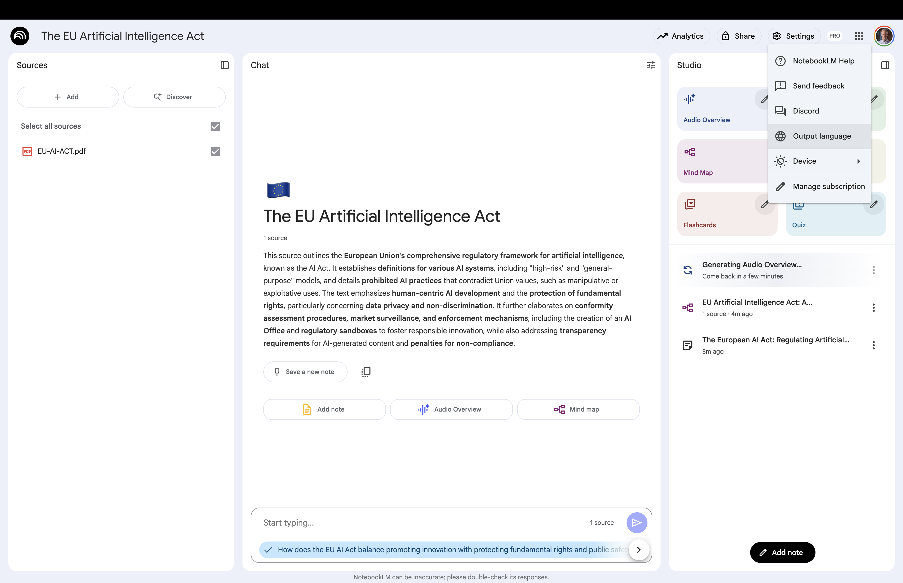
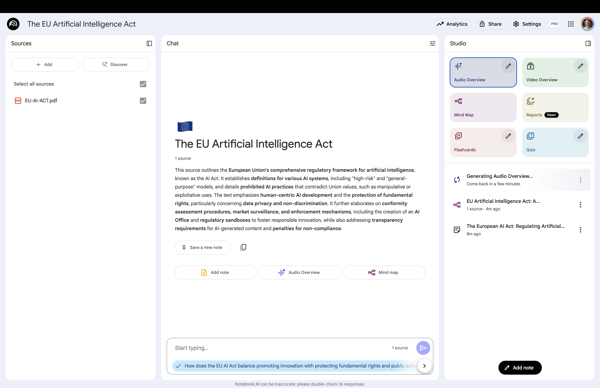
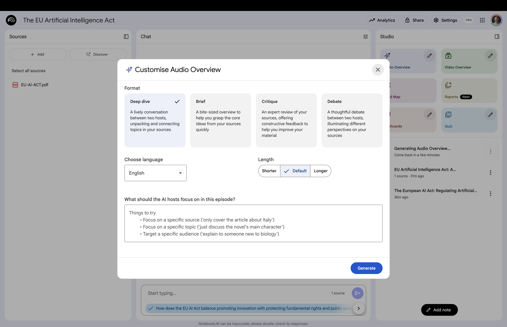
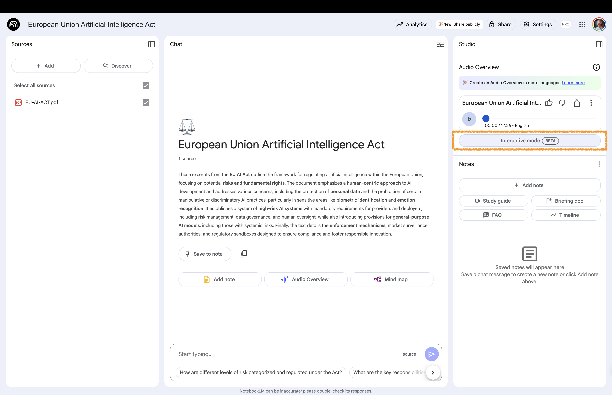
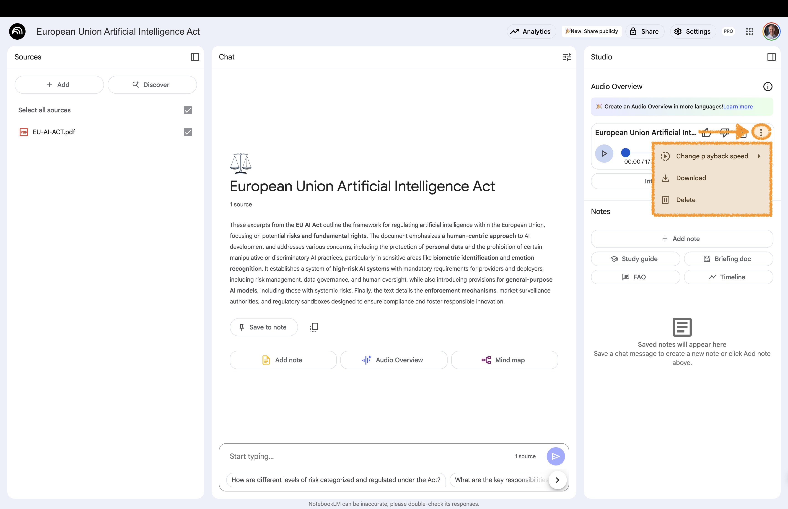

# Audio Overview {background-gradient="linear-gradient(to bottom, #FFDE00, #FFDE00)"}

Audio overviews are audio discussions   
between AI moderators that provide summaries   
of the topics in your uploaded sources

## Choose Output Language 


:::: {.columns}

::: {.column width="60%"}

:::

::: {.column width="40%"}
<br>


**1** Navigate to **Settings** **2** Select the **Output Language**

:::

::::

You can create audio overviews in over 50 languages


## Create an Audio Overview 


:::: {.columns}

::: {.column width="60%"}

:::

::: {.column width="40%"}
<br>


**1** Navigate to the "Studio Panel" 

**2** Click on "Audio Overview" to generate the audio file

:::

::::


## Customise Audio Overviews 


:::: {.columns}

::: {.column width="60%"}

:::

::: {.column width="40%"}


**1** Navigate to the "Audio Overview" section in the **Studio area**

**2** In the top right corner of "Audio Overview" select the pencil symbol 

**3** Choose the format, language and length

:::{.tiny-text}

Format options:

**Deep dive**: A lively conversation between two hosts, unpacking and connecting topics in your sources

**Brief**: A bite-sized overview to help you grasp the core ideas from your sources quickly

**Critique**: An expert review of your sources, offering constructive feedback to help you improve your material

**Debate**: A thoughtful debate between two hosts, illuminating different perspectives on your sources
:::

:::

::::


## Customise Audio Overviews with Prompts


:::: {.columns}

::: {.column width="60%"}

:::

::: {.column width="40%"}


:::{.tiny-text}

Example prompt (adapt the placeholders)

```md
Create an audio overview for [TARGET AUDIENCE] 
with a [TONE] tone. 
Focus on [FOCUS] and aim for [DURATION]. 
Address key insights with concrete examples.

PLACEHOLDERS

[TARGET AUDIENCE] = Kärcher management
[TONE] = professional
[FOCUS] = practical insights  
[DURATION] = 8-10 min.
```
:::

:::

::::


## Interact with an Audio Overview 


:::: {.columns}

::: {.column width="60%"}

:::

::: {.column width="40%"}
<br>

Select **Interactive Mode** (BETA)

Select **Play Audio**

While listening, select **Join** and ask a question


:::

::::


## Manage Your Audio Overview 


:::: {.columns}

::: {.column width="60%"}

:::

::: {.column width="40%"}
<br>

Change speed, download your audio, or delete it


Select "More" to:

**1** Change the playback speed

**2** Download the audio as mp3

**3** Delete the audio overview


:::

::::

# Back to Website {background-gradient="linear-gradient(to bottom, #FFDE00, #FFDE00)"}


[Workshop Website](https://kirenz.github.io/notebooklm/)