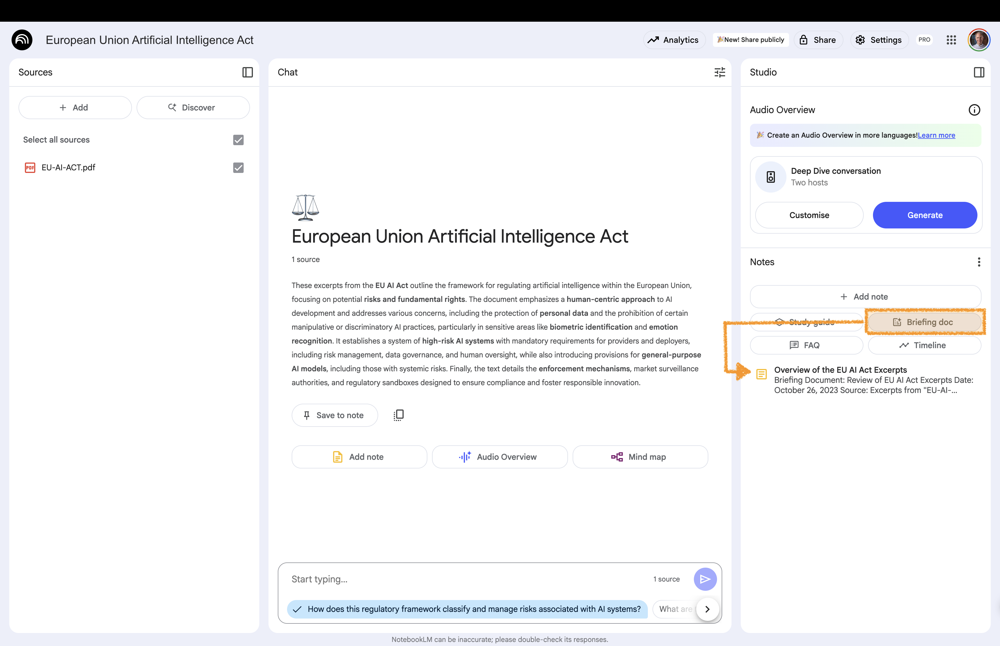
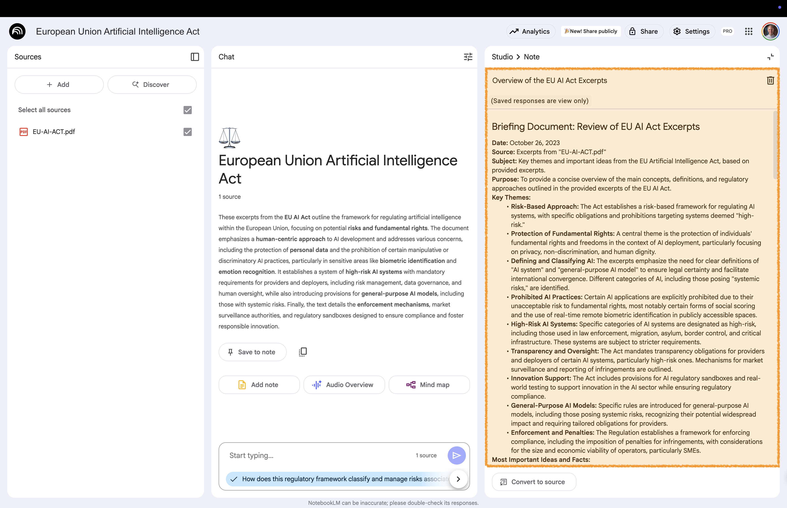

# Briefing Document {background-gradient="linear-gradient(to bottom, #FFDE00, #FFDE00)"}

Summarizes key topics, definitions, and timelines  
from the provided sources 

## Create an Overview of Key Topics

:::: {.columns}

::: {.column width="60%"}

:::

::: {.column width="40%" .fragment .fade-up}
 

**Studio area**:  
Click on **Briefing Doc.**

:::

::::

## Open Briefing Document

:::: {.columns}

::: {.column width="60%"}

:::

::: {.column width="40%" .fragment .fade-up}
 

**Studio area**:  
Open the newly created note

Take a look at the briefing document 

:::

::::

# Back to Website {background-gradient="linear-gradient(to bottom, #FFDE00, #FFDE00)"}

[Workshop Website](https://kirenz.github.io/notebooklm/)