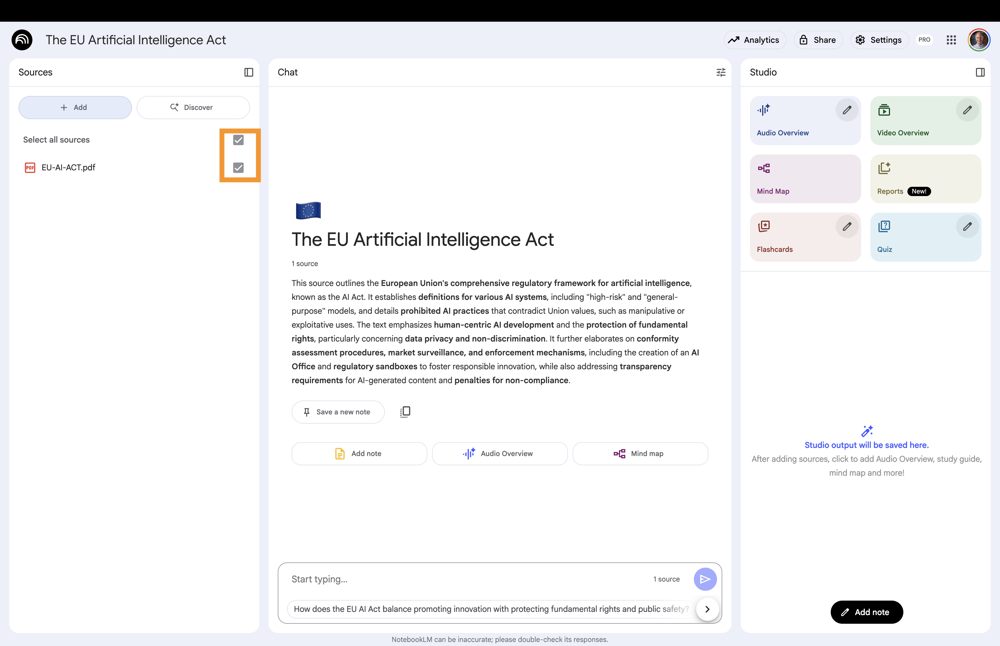
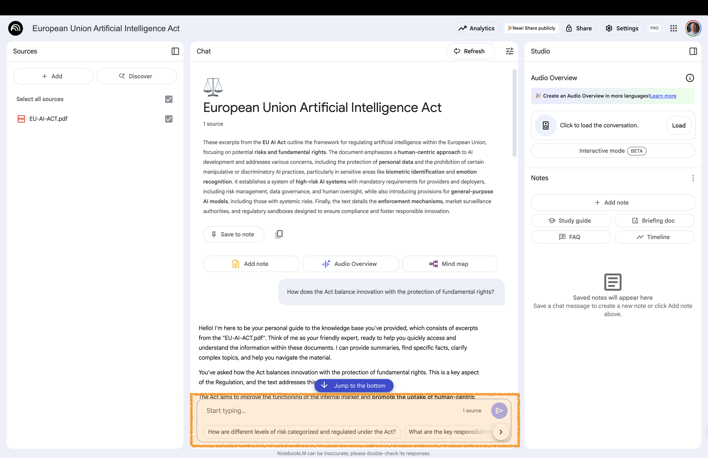
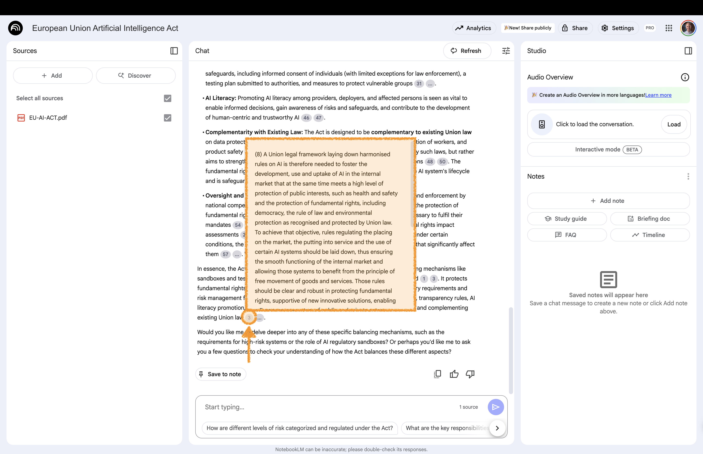
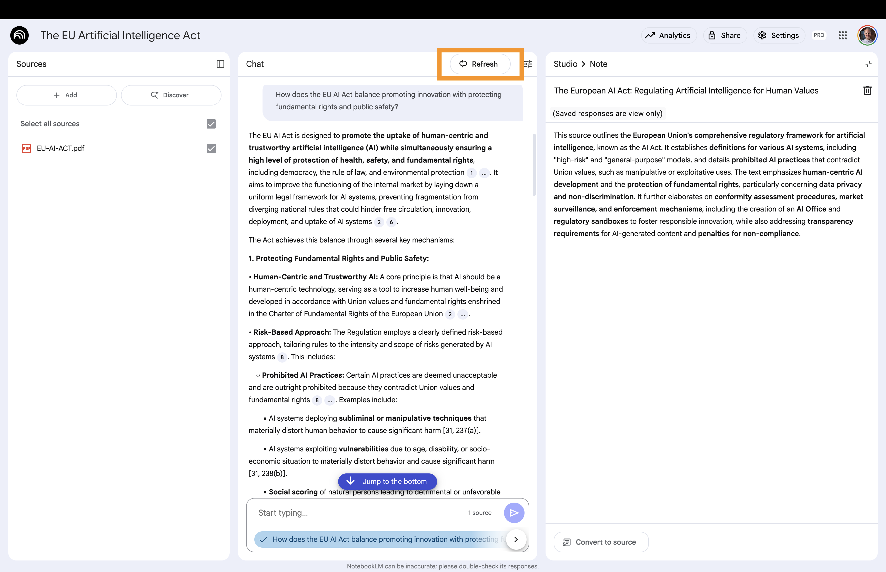
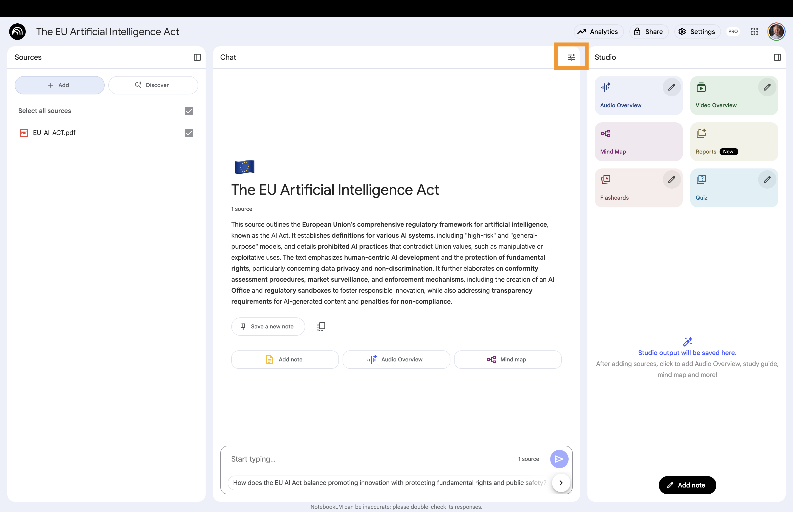
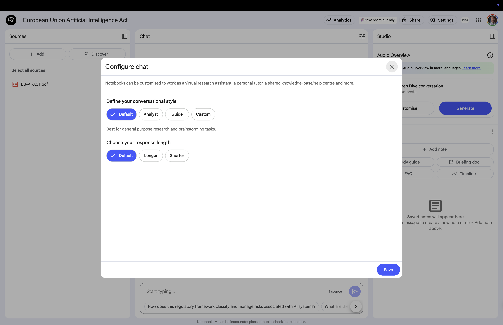
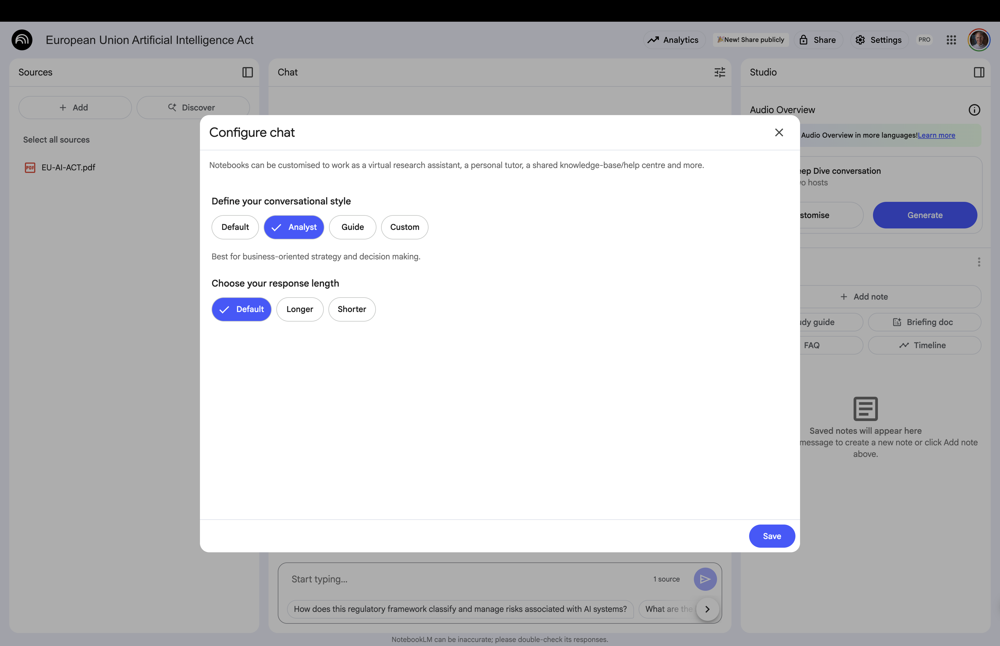
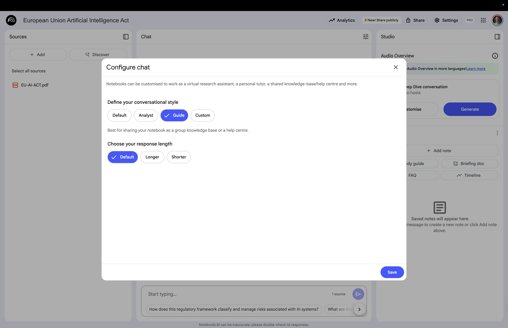
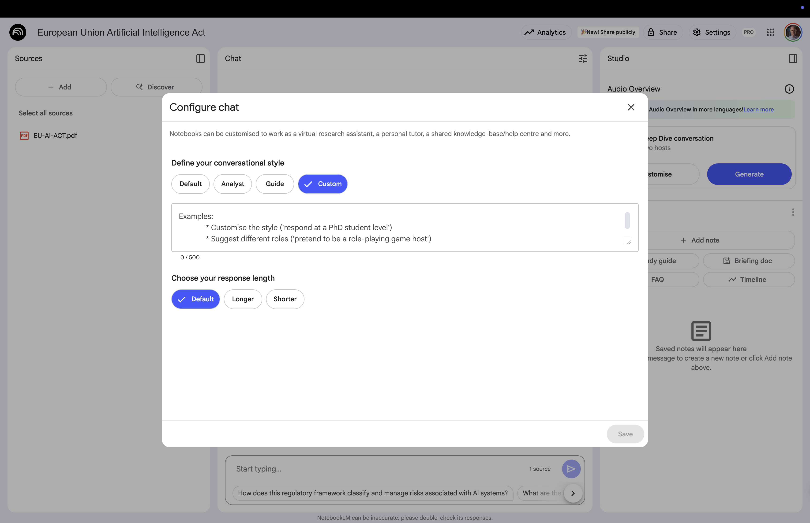

# Chat {background-gradient="linear-gradient(to bottom, #FFDE00, #FFDE00)"}

Ask the model questions about your   
source material or give it instructions   
to perform actions

## Select Sources 

:::: {.columns}

::: {.column width="60%"}

:::

::: {.column width="40%" .fragment .fade-left}
<br>

Use the checkbox next to each source to include or exclude specific sources that the model should use to answer your question

:::

::::


:::: {.columns}

::: {.column width="56%" }

:::{.callout-note .fragment .fade-up}

You can add or remove sources by selecting **+ Add** or deselecting individual sources in the **Sources panel**

:::

:::

::::


## Ask the Model Questions

:::: {.columns}

::: {.column width="60%"}

:::

::: {.column width="40%" .fragment .fade-left}
<br>

Enter a question in the chat window


:::{.tiny-text .fragment .fade-up}
For example:

```md
What are the key insights  
from this document?
```
:::


:::

::::


## Citations 

:::: {.columns}

::: {.column width="60%"}

:::

::: {.column width="40%" .fragment .fade-left}
<br>

Select a citation to navigate to the location of the citation

:::

::::


:::: {.columns}

::: {.column width="56%" }

:::{.callout-note .fragment .fade-up}

You can hover over any citation to get the full quoted text

:::
:::
::::


## Clear Chat 

:::: {.columns}

::: {.column width="60%"}

:::

::: {.column width="40%" .fragment .fade-left}
<br>

To delete the chat history, select **Refresh**

:::

::::


## Customize Chat 


:::: {.columns}

::: {.column width="60%"}

:::

::: {.column width="40%" .fragment .fade-left}
<br>


Navigate to **Configure notebook** in the chat area

:::

::::


You can change the conversation style and response length


## Conversation Style: Default 


:::: {.columns}

::: {.column width="60%"}

:::

::: {.column width="40%" .fragment .fade-left}
<br>

:::

::::

**Default**: Best for general research and brainstorming tasks.


## Conversation Style: Analyst 


:::: {.columns}

::: {.column width="60%"}

:::

::: {.column width="40%"}

:::

::::

**Analyst**: Best for business-oriented strategy and decision making.


## Conversation Style: Guide 

:::: {.columns}

::: {.column width="60%"}

:::

::: {.column width="40%"}


:::

::::

**Guide**: Use your notebook as a knowledge base or help center

## Conversation Style: Custom 


:::: {.columns}

::: {.column width="60%"}

:::

::: {.column width="40%" .fragment .fade-left}


:::

::::


**Custom**: Best for choosing a specific role


**Response Length**: You can also choose the response length: *Default*, *Longer* and *Shorter*

# To the Website {background-gradient="linear-gradient(to bottom, #FFDE00, #FFDE00)"}


[Workshop Website](https://kirenz.github.io/notebooklm/)