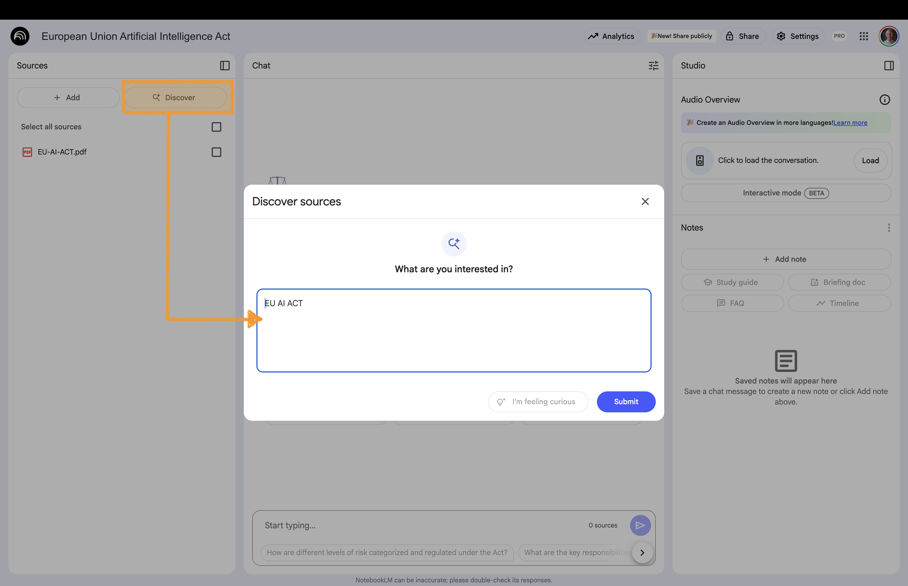
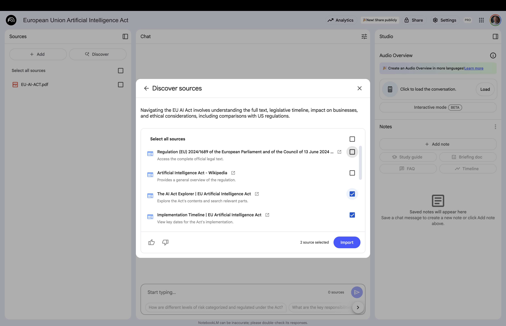
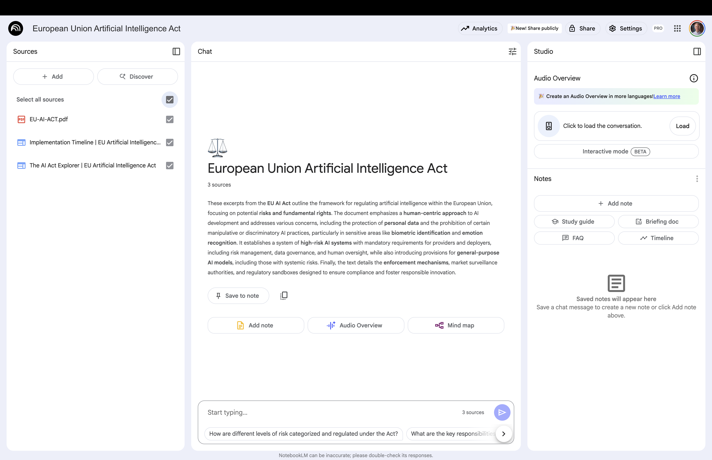

# Discover Sources {background-gradient="linear-gradient(to bottom, #FFDE00, #FFDE00)"}

Allows you to discover relevant sources from the web   
and import them directly into your notebook

## Discover New Sources 

:::: {.columns}

::: {.column width="60%"}

:::

::: {.column width="40%" .fragment .fade-left}
 

**Sources area**:  
Click on **Discover**

Enter any topic of interest (here we entered EU AI Act)

:::

::::

## Select and Add Discovered Sources 

:::: {.columns}

::: {.column width="60%"}

:::

::: {.column width="40%" .fragment .fade-left}
 

Select the discovered sources you want to keep

:::

::::

## Use New Sources 

:::: {.columns}

::: {.column width="60%"}

:::

::: {.column width="40%" .fragment .fade-left}
 

Select the sources you want to work with and create new content (like mindmaps, etc.)

:::

::::

# Back to Website {background-gradient="linear-gradient(to bottom, #FFDE00, #FFDE00)"}

[Workshop Website](https://kirenz.github.io/notebooklm-de/)