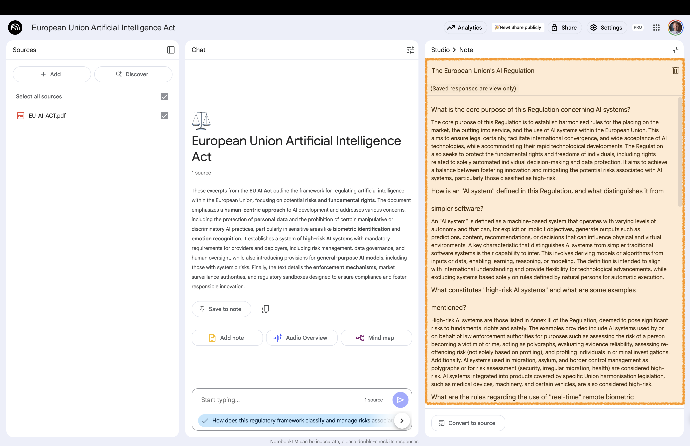

# FAQ {background-gradient="linear-gradient(to bottom, #FFDE00, #FFDE00)"}

Creates "question-answer" pairs to get a general,   
structured overview of the main topics in your documents

## Create FAQs 

:::: {.columns}

::: {.column width="60%"}

:::

::: {.column width="40%" .fragment .fade-up}
 

**Studio area**:  
Click on **FAQ**

:::

::::

Creates a "question-answer" pair format

## Open FAQ 

:::: {.columns}

::: {.column width="60%"}

:::

::: {.column width="40%" .fragment .fade-up}
 

**Studio area**:  
Open the newly created note

Take a look at the FAQ

:::

::::

# Back to Website {background-gradient="linear-gradient(to bottom, #FFDE00, #FFDE00)"}

[Workshop Website](https://kirenz.github.io/notebooklm/)