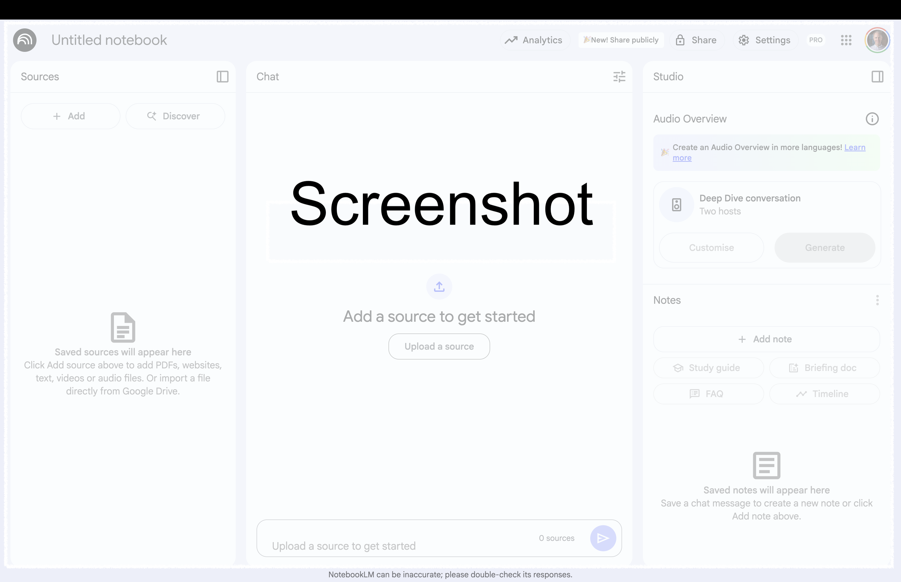
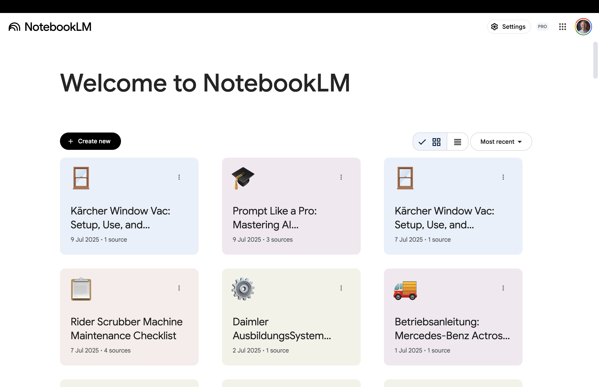
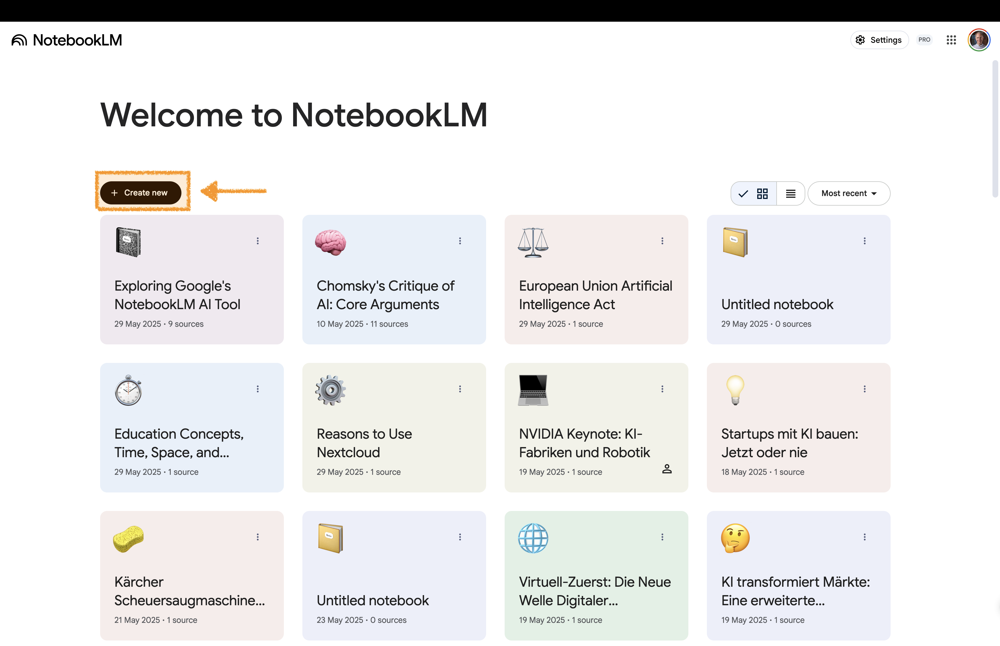
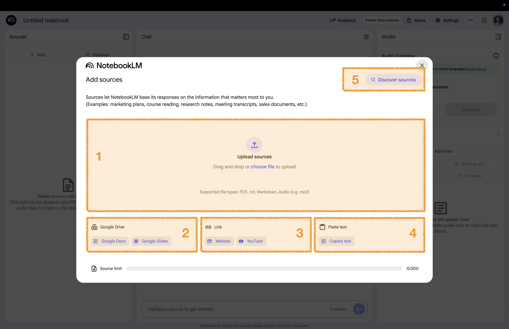
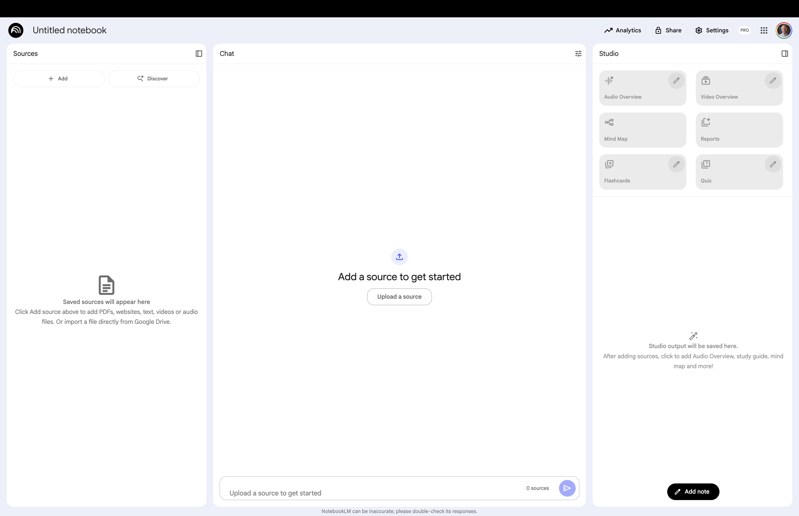
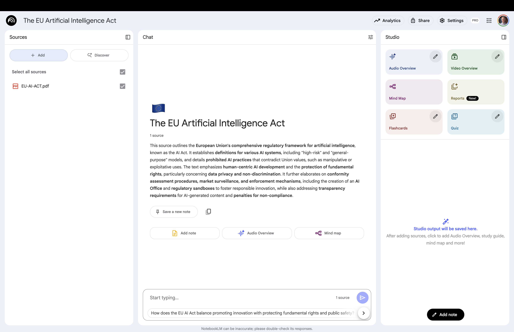
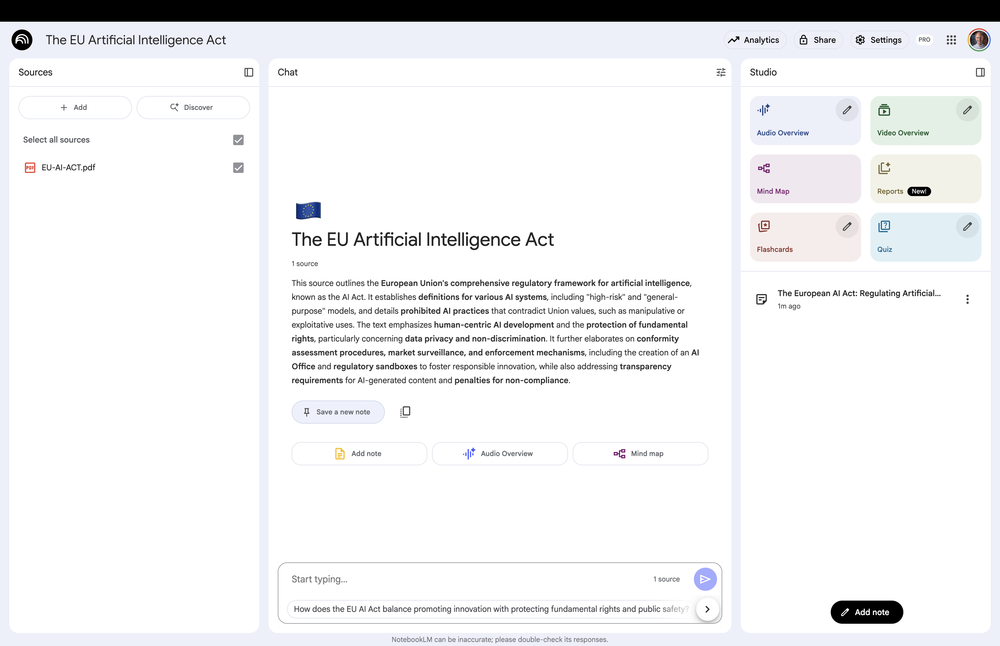
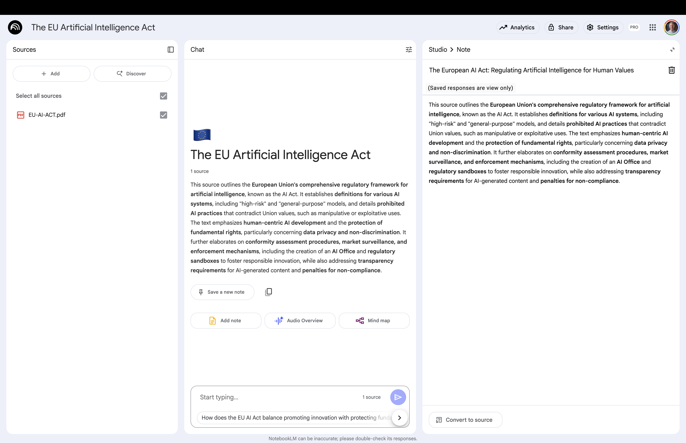

# Your First Notebook {background-gradient="linear-gradient(to bottom, #FFDE00, #FFDE00)"}

A notebook is simply a collection   
of sources for a specific project.

## Notes on Slide Structure

Most slides follow the structure shown in this slide

:::: {.columns}

::: {.column width="60%" .fragment .fade-up}

:::

::: {.column width="40%"  .fragment .fade-left }

 

Here you see your instructions.

Follow the steps shown here. 

:::

::::

. . .

:::: {.columns}

::: {.column width="56%" }

:::{.callout-note .fragment .fade-up}

This part gives you only additional context or tips

:::

:::
::::

## Open NotebookLM

:::: {.columns}

::: {.column width="60%" .fragment .fade-up}

:::

::: {.column width="40%"  .fragment .fade-left .custom-small}

 

On your device: 

[🔗 Open NotebookLM](https://notebooklm.google/)

:::

::::

. . .

:::: {.columns}

::: {.column width="56%" }

:::{.callout-note .fragment .fade-up}

NotebookLM cannot delete or edit your original files in Google Drive

:::

:::
::::

## Create a New Notebook 

:::: {.columns}

::: {.column width="60%" .fragment .fade-up}

:::

::: {.column width="40%" .fragment .fade-left}
 

To create a new notebook, select: 

**+ New**
:::

::::

## Add Your Sources  

:::: {.columns}

::: {.column width="60%" .fragment .fade-up}

:::

::: {.column width="40%"  .fragment .fade-left .custom-small}

 

Select a document you want to explore 

:::{.small-text}
I'm using the [EU AI Act](images/notebooklm/EU-AI-ACT.pdf) as an example
:::

Add the document 

:::

::::

. . .

:::: {.columns}

::: {.column width="56%" }

:::{.callout-note .fragment .fade-up}

You can add up to 300 sources: **(1)** PDF, PPT, Excel, Audio, Images **(2)** Google Docs or Google Slides 
**(3)** Website or YouTube **(4)** Copied text **(5)** Search the web
:::

:::
::::

## Three Core Areas 

:::: {.columns}
::: {.column width="80%" .fragment .fade-up}

{width="80%"}
:::

::: {.column width="20%" }

:::

::::

. . .

:::: {.columns}

::: {.column width="20%" .tiny-text }
**Sources Section**: Upload and manage documents.   

:::

::: {.column width="30%" .tiny-text }
**Chat Section**: Ask questions and get answers based on your documents.  
:::

::: {.column width="30%" .tiny-text }
**Studio Section**: Generate and save outputs like summaries, study guides, and notes.  
:::

::::

## Automatically Generated Summary 

:::: {.columns}

::: {.column width="60%" }

:::

::: {.column width="40%"}

 

:::

::::

:::: {.columns}

::: {.column width="56%" }

:::{.callout-note .fragment .fade-up}

The summary is automatically generated

:::

:::
::::

## Save Summary as Note 

:::: {.columns}

::: {.column width="60%"}

:::

::: {.column width="40%" .fragment .fade-left}
 

**1** In the **Chat Section**: 

Select **Save to note**

:::

::::

:::: {.columns}

::: {.column width="56%" }

:::{.callout-note .fragment .fade-up}

**2** The note appears in the "Notebook" within the **Studio Section**

:::

:::
::::

## Open the Note 

:::: {.columns}

::: {.column width="60%"}

:::

::: {.column width="40%" .fragment .fade-left}
 

Click on the note in the **Studio Section**

(it will open in a new window)

:::

::::

:::: {.columns}

::: {.column width="56%" }

:::{.callout-note .fragment .fade-up}

Saved answer notes are not editable

:::

:::
::::

# To the Website {background-gradient="linear-gradient(to bottom, #FFDE00, #FFDE00)"}

[Workshop Website](https://kirenz.github.io/notebooklm/)