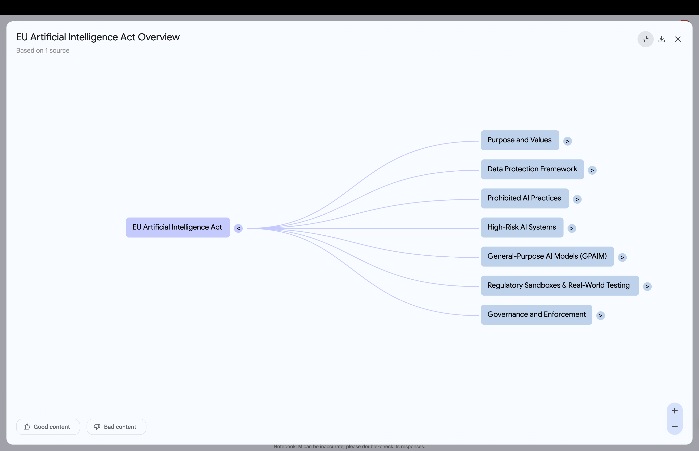
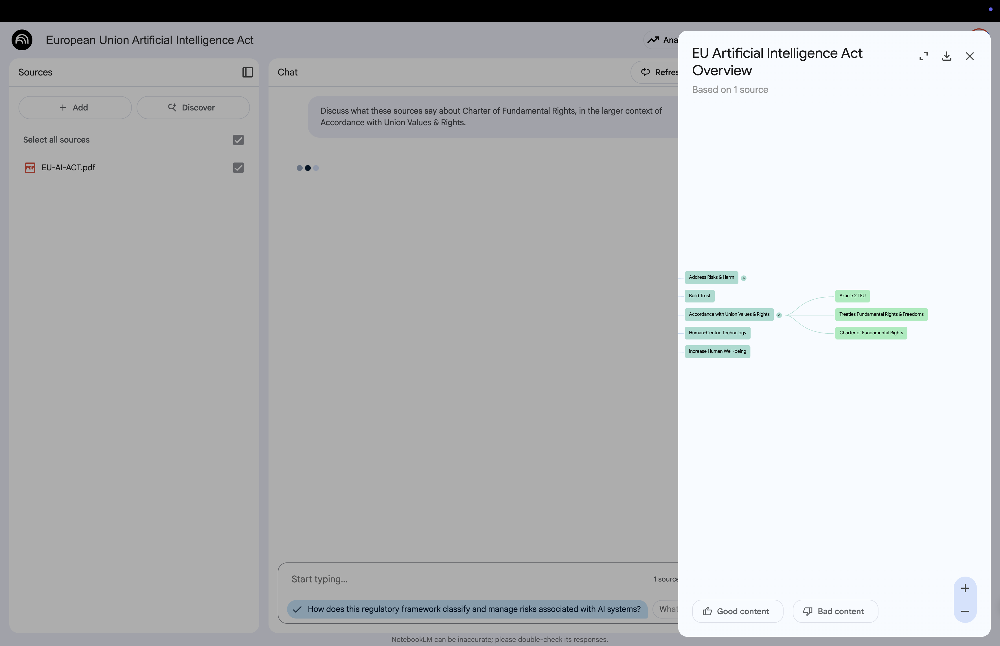

# Mindmap {background-gradient="linear-gradient(to bottom, #FFDE00, #FFDE00)"}

Mindmaps visually summarize your uploaded sources,  
showing main topics and related ideas as  
a branched diagram

## Create a Mindmap 

:::: {.columns}

::: {.column width="60%"}

:::

::: {.column width="40%"}
 

**1** Select the mindmap chip in the **Chat area**

**2** The mindmap appears in the **Studio area**

:::

::::

## How to Interact with a Mindmap 

:::: {.columns}

::: {.column width="60%"}

:::

::: {.column width="40%"}
 

Open the mindmap in the **Studio area**

Expand or collapse branches with **>**

Change view, download, or exit (top right corner)

:::

::::

## Select Nodes to Ask Questions

:::: {.columns}

::: {.column width="60%"}

:::

::: {.column width="40%"}
 

Select a node to ask questions and chat about that specific topic

:::

::::

# Back to Website {background-gradient="linear-gradient(to bottom, #FFDE00, #FFDE00)"}

[Workshop Website](https://kirenz.github.io/notebooklm/)
