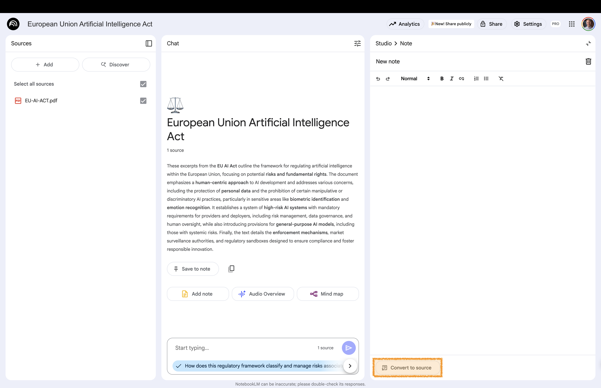

# Notes {background-gradient="linear-gradient(to bottom, #FFDE00, #FFDE00)"}

Organize information and add your own thoughts

## Create & Add Notes 

:::: {.columns}

::: {.column width="60%"}

:::

::: {.column width="40%" .fragment .fade-up}
 

**Studio area**:  
Select **Add Note** in the **Notes** section

You can write or paste text into this note

:::

::::

You can create up to 1,000 notes per notebook

## Convert Notes to Sources

:::: {.columns}

::: {.column width="60%"}

:::

::: {.column width="40%" .fragment .fade-up}
 

**Studio area**:  
Open the note

Select **Convert to Source**

:::{.small-text .fragment .fade-up}

---

*To convert all notes to sources:* Click on **More** in the **Notes** section in the **Studio area**. 

Select **Convert All Notes to Sources**

:::

:::

::::

. . .

You can add your notes to your sources 

# Back to Website {background-gradient="linear-gradient(to bottom, #FFDE00, #FFDE00)"}

[Workshop Website](https://kirenz.github.io/notebooklm/)