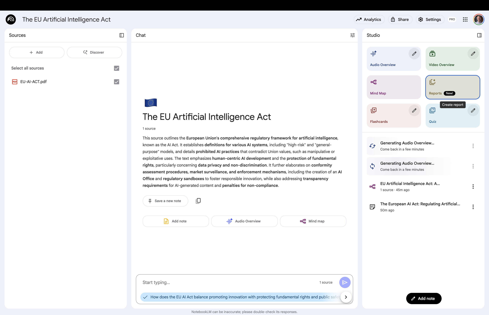
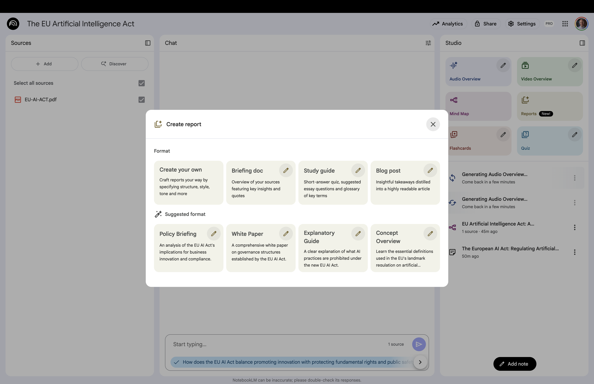

# Reports {background-gradient="linear-gradient(to bottom, #FFDE00, #FFDE00)"}

Automates the process of identifying key vocabulary   
and formulating relevant quiz questions

## Report

:::: {.columns}

::: {.column width="60%"}

:::

::: {.column width="40%" .fragment .fade-left}
 

**Studio area**:  
Click on **Report**

:::

::::

This Opens a new window with more options

## Check the Report Options

:::: {.columns}

::: {.column width="60%"}

:::

::: {.column width="40%" .fragment .fade-left}
 

:::{.tiny-text}

**Create your own**: Craft reports your way by specifying structure, style, tone and more

**Briefing doc**: Overview of your sources featuring key insights and quotes

**Study guide**: Short-answer quiz, suggested essay questions and glossary of key terms

**Blog post**: Insightful takeaways distilled into a highly readable article

**Suggested formats**: More options to choose from

:::

:::

::::

# Back to Website {background-gradient="linear-gradient(to bottom, #FFDE00, #FFDE00)"}

[Workshop Website](https://kirenz.github.io/notebooklm/)