## Welcome to the Workshop! {background-gradient="linear-gradient(to bottom, #FFDE00, #FFDE00)"}


## About Me 

:::: {.columns}

::: {.column width="30%"}

{width="60%"}

Jan Kirenz  

<div class="tiny-text">
Stuttgart Media University  
[kirenz@hdm-stuttgart.de](kirenz@hdm-stuttgart.de)  

Learning Facilitator, AI Consultant & Trainer
</div>

:::

::: {.column width="70%"}

::: {style="position: relative; height: 400px;"}
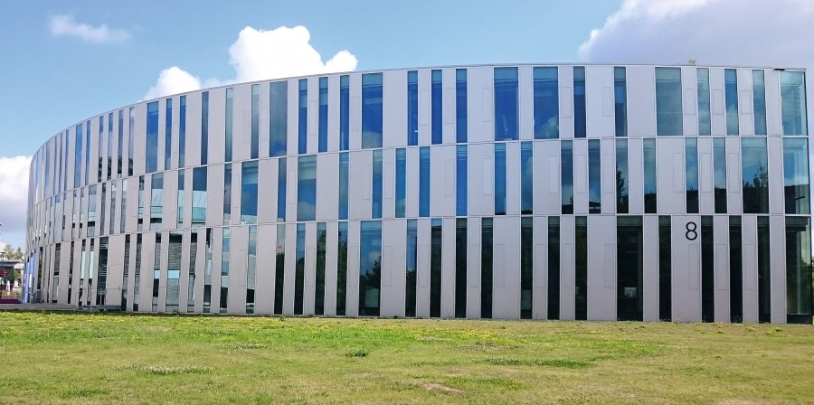{.fragment .fade-in style="position: absolute; width: 70%; top: 0px; left: 0px; z-index: 1;"}

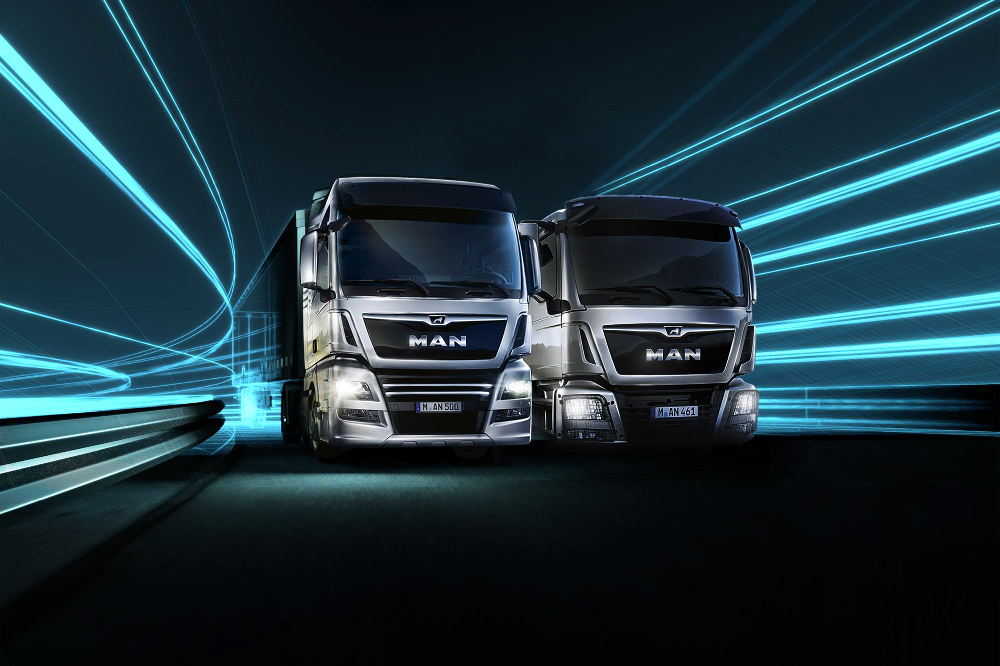{.fragment .fade-in style="position: absolute; width: 70%; top: 80px; left: 100px; z-index: 2;"}

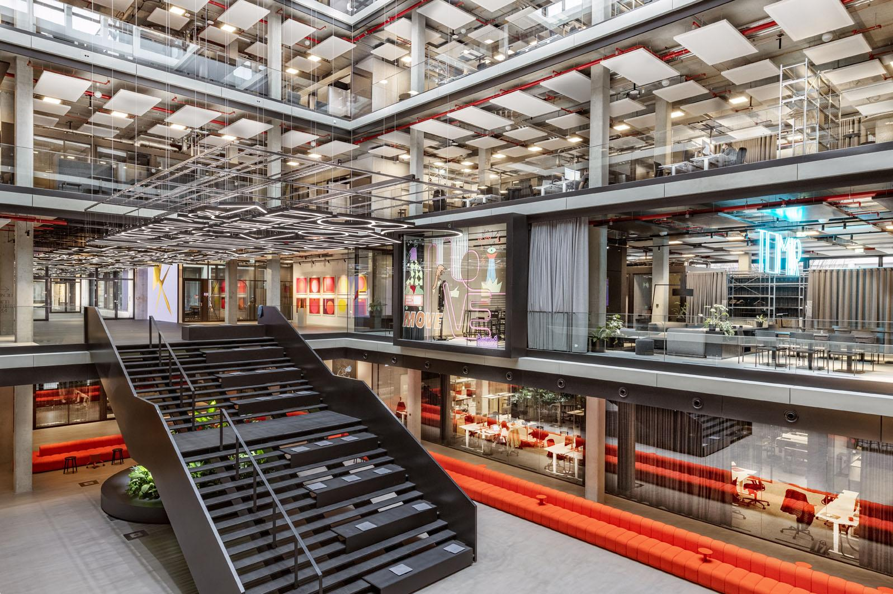{.fragment .fade-in style="position: absolute; width: 70%; top: 160px; left: 200px; z-index: 3;"}

::: 

:::

::::


# 1. Introduction {background-color="#FFED00"}


## A Reality Check to Start

:::: {.columns}

::: {.column width="60%" .fragment .fade-up}
{width="100%"}
:::

::: {.column width="40%" .fragment .fade-left}

<br>

**Please answer questions in the brief anonymous [Google Forms survey](https://forms.gle/zYm4ohv9MVh6AGfn7).**

The link is in the chat.


:::

::::


## Information Overload

:::: {.columns}

::: {.column width="60%" .fragment .fade-up}

:::

::: {.column width="40%" .fragment .fade-left }

<br>

**Does this sound familiar?**

- Too much information, too little time.

:::{.callout-tip .fragment .fade-up appearance="simple"}

**The Vision:** Have a conversation with any document and get precise answers instantly.

:::

:::

::::


## AI = Personal Assistant

:::: {.columns}

::: {.column width="60%"}

:::

::: {.column width="40%" .fragment .fade-left}

<br>

- Upload documents, ask questions, and get precise answers with sources instantly.


:::{.callout-tip .fragment .fade-up appearance="simple"}

**The biggest advantage:** It exclusively uses the provided documents.

:::
:::

::::


## Our Learning Journey

:::: {.columns}

::: {.column width="60%" .fragment .fade-up}
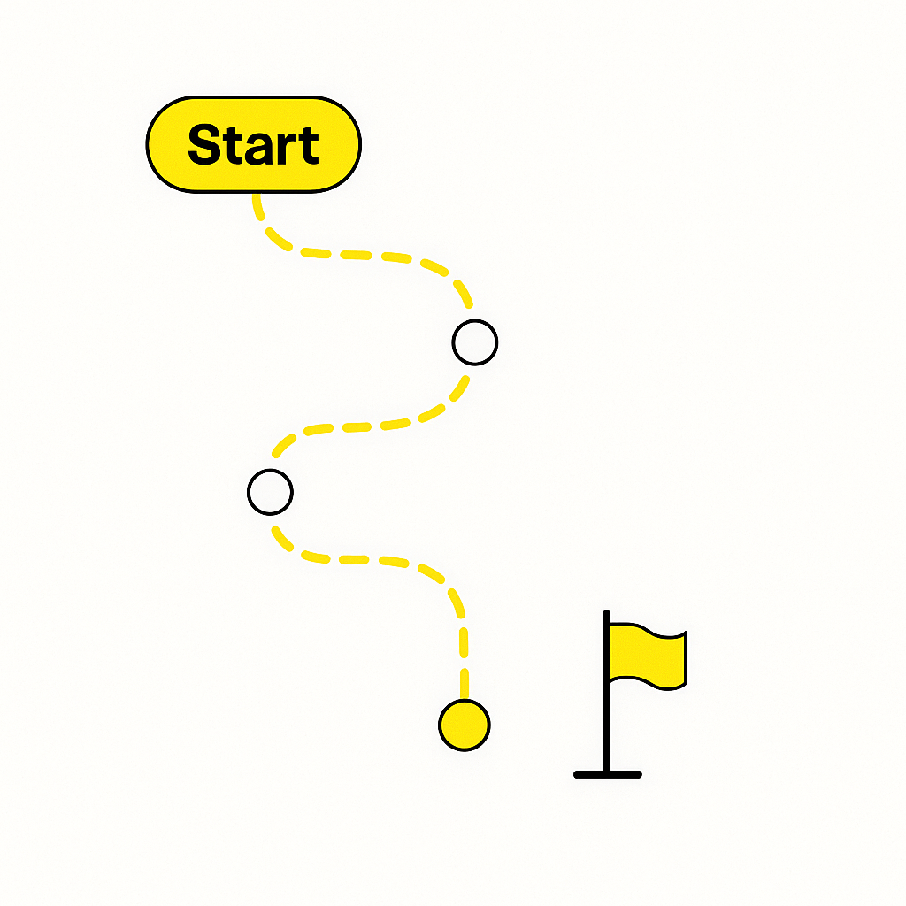
:::

::: {.column width="40%" .fragment .fade-left }

<br>
<br>

**Agenda**

**1** Introduction 

**2** Exercises - Quick Wins 

**3** Use Cases 

**4** Implementation Plan 

**5** Conclusion
:::

::::

# 1. Introduction {background-gradient="linear-gradient(to bottom, #FFDE00, #FFDE00)"}

## The Personal Assistant

:::: {.columns}
::: {.column width="40%" .fragment .fade-right}
{width=100%}
:::
::: {.column width="60%" .fragment .fade-left}

<br>

NotebookLM as (Junior) Assistant


**Clear Instructions** → Better Results

:::
::::


## How to "Talk" to NotebookLM?


<div style="text-align: center;">

```{mermaid}

%%{init: {
  'theme': 'base',
  'themeVariables': {
    'primaryColor': '#ffffff',
    'primaryTextColor': '#374151',
    'primaryBorderColor': '#e5e7eb',
    'lineColor': '#9CA3AF',
    'secondaryColor': '#f9fafb',
    'tertiaryColor': '#ffffff',
    'fontFamily': 'system-ui',
    'fontSize': '24px',
    'nodeSpacing': 150,
    'rankSpacing': 150
  }
}}%%

flowchart LR
    subgraph Input[" "]
        direction TB
        A["Prompt"]
        D["Sources"]
        style A fill:#FFED00,color:#374151,stroke:#FFED00,padding:30px
        style D fill:#FFED00,color:#374151,stroke:#FFED00,padding:30px
    end

    subgraph Model[" "]
        direction TB
        B["NotebookLM"]
        style B fill:#ffffff,color:#374151,stroke:#e5e7eb,padding:30px
    end

    subgraph Output[" "]
        direction TB
        C["Output"]
        style C fill:#FFED00,color:#374151,stroke:#FFED00,padding:30px
    end

    A --> B
    D --> B
    B --> C

    style Input fill:#ffffff,stroke:#e5e7eb,color:#374151,stroke-width:1px,padding:50px
    style Model fill:#ffffff,stroke:#e5e7eb,color:#374151,stroke-width:1px,padding:50px
    style Output fill:#ffffff,stroke:#e5e7eb,color:#374151,stroke-width:1px,padding:50px

    linkStyle default stroke:#9CA3AF,stroke-width:2px
```

</div>

::: {.tiny-text .fragment .fade-up}

| **Element** | **Description** |
|----------------|---------------------------------------------------------|
| **Sources** | The documents that have been added to the notebook |
| **Prompt** | The question or instruction                               |
| **NotebookLM** | Uses Google's Gemini to understand and respond   |
| **Output** | Text, mind map, or audio response                        |

:::

<!-- 

## Schlüsselmerkmale 

:::: {.columns}
::: {.column width="40%" .fragment .fade-right}

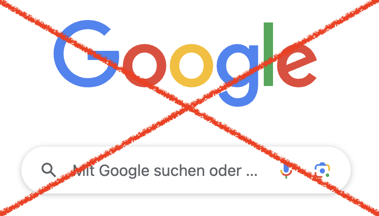{width=100%}

**Nicht wie die Google-Suche**:

Suche: Findet vorhandene Inhalte  

KI: Generiert neue Inhalte

:::
::: {.column width="60%" .fragment .fade-left}

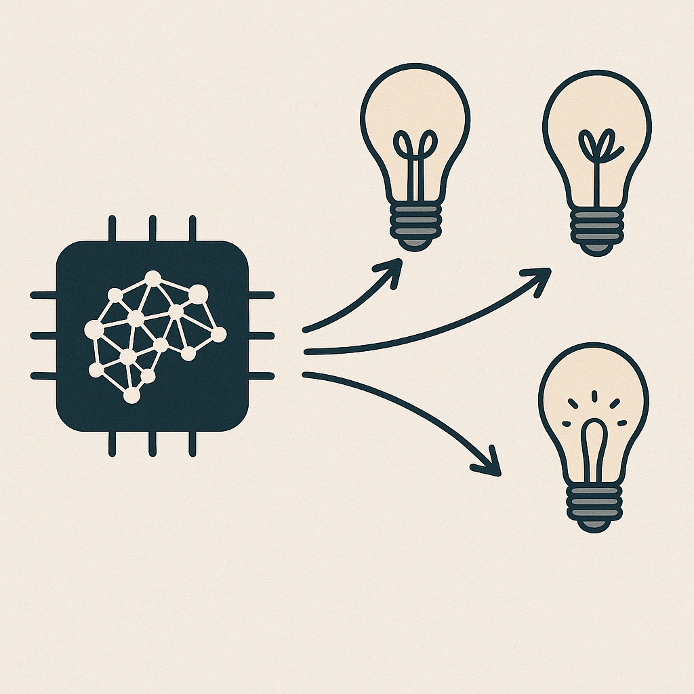{width=35%}

**Oft nicht deterministisch**:

Gleicher Prompt ≈ unterschiedliche Ausgaben

"Kreatives" Merkmal; ermöglicht Vielfalt

:::
:::: -->


## Limitations of NotebookLM

:::: {.columns}

::: {.column width="33%" .fragment .fade-up}
{width="100%"}

**Factual Errors**: Can produce incorrect information
:::

::: {.column width="33%" .fragment .fade-up }
{width="100%"}

**Hallucinations**: Produces fabricated content (less common than other AI tools)
:::


::::


## Prompting Basics

:::: {.columns}

::: {.column}


In this presentation, prompts are displayed as follows:

```md
This is an example prompt
```

<div class="tiny-text">
The prompt can be copied using the icon in the top right.
</div>


:::

::::

<!-- 

## Spezifische Prompts

:::: {.columns}

::: {.column width="50%" .fragment .fade-right}

#### ❌ Allgemeiner Prompt

```markdown
Analysiere das Kundenfeedback
für Kärcher Hochdruckreiniger
```

:::
::: {.column width="50%" .fragment .fade-right}

#### ✅ Spezifischer Prompt

```md
Analysiere das Kundenfeedback 
für Kärcher Hochdruckreiniger

Erstelle eine tabellarische Übersicht
mit Fokus auf Usability-Probleme
für das Produktentwicklungsteam
```

:::
::::

::: {.callout-tip .fragment .fade-down appearance="minimal"} 
#### Wichtige Elemente:
- Definiertes Ergebnis
- Relevanter Kontext (z.B. Abteilung/Rolle)
- Klare Zielgruppe
:::

## Rollen-Prompting

:::: {.columns}
::: {.column width="50%" .fragment .fade-right}

#### ❌ Allgemeiner Prompt

```markdown
Erkläre die Vorteile unserer 
neuen Reinigungstechnologie 
für potenzielle Kunden.
```

:::
::: {.column width="50%" .fragment .fade-right}

#### ✅ Gezielter Prompt

```markdown
Erkläre die Vorteile unserer 
neuen Reinigungstechnologie 
für potenzielle Kunden.

Handle als erfahrener Kärcher 
Vertriebsmitarbeiter.
```

:::
::::

::: {.callout-tip .fragment .fade-down appearance="minimal"} 
#### Maßgeschneiderte Expertise

- Die Antwort passt sich an die definierte berufliche Rolle an
- Unterschiedliche Rollen liefern unterschiedliche Perspektiven
- Ideal für abteilungsspezifische Kommunikation
:::

## Platzhalter

:::: {.columns}
::: {.column width="50%" .fragment .fade-up}

#### Prompt-Beispiel A

```markdown
Erstelle ein Projekt-Update 
für Stakeholder über [THEMA].
Zielgruppe: [ZIELGRUPPE].

[THEMA] = "Nachhaltigkeitsinitiativen"
[ZIELGRUPPE] = "Geschäftsführung"
```

:::
::: {.column width="50%" .fragment .fade-up}

#### Prompt-Beispiel B

```markdown
Erstelle ein Projekt-Update 
für Stakeholder über [THEMA].
Zielgruppe: [ZIELGRUPPE].

[THEMA] = "neue Produkteinführung"
[ZIELGRUPPE] = "Vertriebsteam"
```

:::
::::

::: {.callout-tip .fragment .fade-down appearance="minimal"} 
#### Vorteile
- Inhalte für verschiedene Abteilungen anpassen
- Variationen für verschiedene Zielgruppen testen
- Erfolgreiche Prompt-Vorlagen wiederverwenden
:::

 -->


# The First Notebook {background-gradient="linear-gradient(to bottom, #FFDE00, #FFDE00)"}


A notebook is a collection of sources   
for a specific project.


## Notes on Slide Structure

Most slides follow the structure shown here.


:::: {.columns}

::: {.column width="60%" .fragment .fade-up}
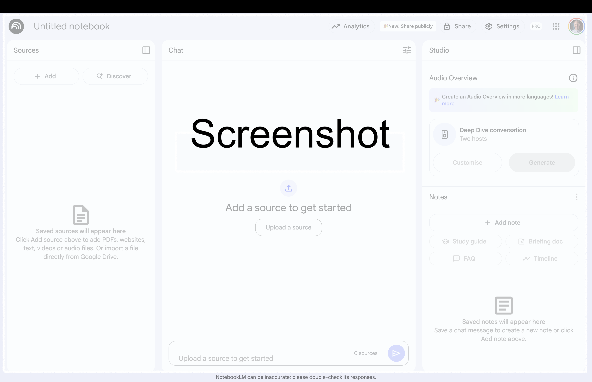
:::

::: {.column width="40%"  .fragment .fade-left }

<br>

Here you'll find the instructions.

The steps shown serve as guidance.

:::

::::

. . .


:::: {.columns}

::: {.column width="56%" }

::: {.callout-note .fragment .fade-up}

This section provides additional context or tips.

:::

:::
::::


## Opening NotebookLM


:::: {.columns}

::: {.column width="60%" .fragment .fade-up}
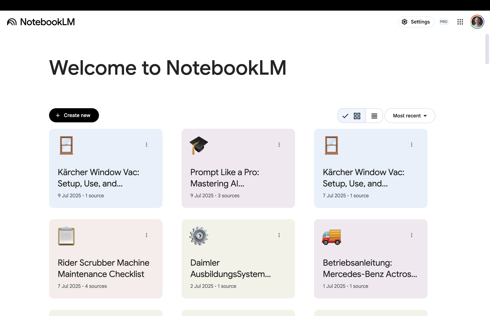
:::

::: {.column width="40%"  .fragment .fade-left .custom-small}

<br>

On your own device: 

[🔗 Open NotebookLM](https://notebooklm.google/)


:::

::::

. . .


:::: {.columns}

::: {.column width="56%" }

:::{.callout-note .fragment .fade-up}

NotebookLM cannot delete or edit original files in Google Drive.

:::

:::
::::


## Creating a New Notebook 


:::: {.columns}

::: {.column width="60%" .fragment .fade-up}
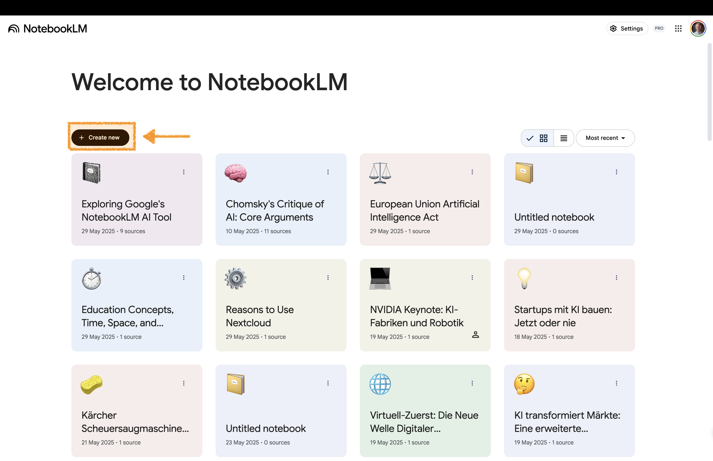
:::

::: {.column width="40%" .fragment .fade-left}
<br>

To create a new notebook, select: 

**+ Create new**
:::

::::


## Adding Sources  


:::: {.columns}

::: {.column width="60%" .fragment .fade-up}
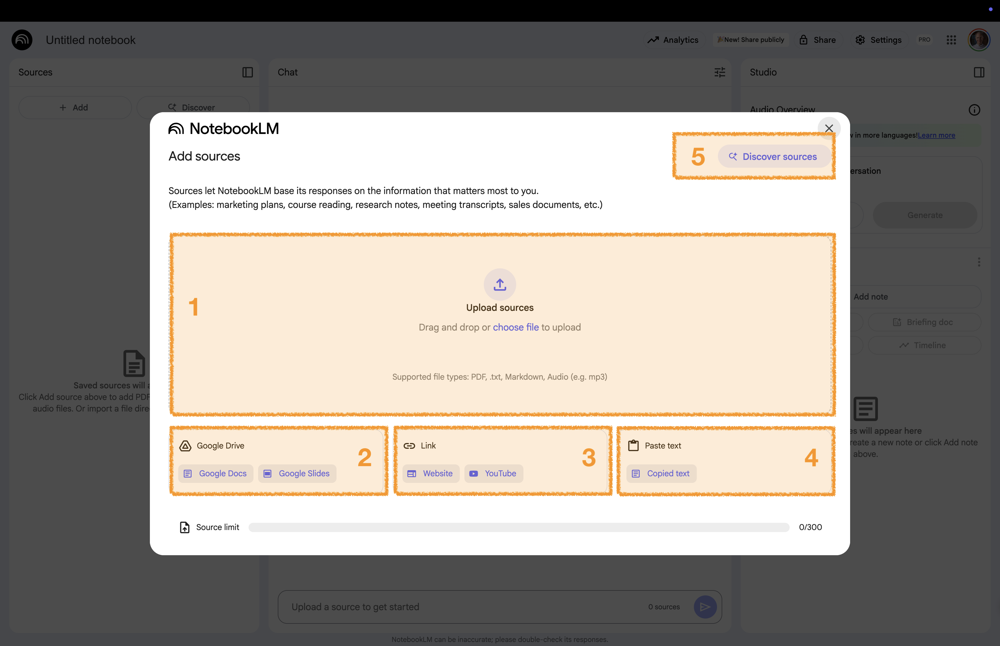
:::

::: {.column width="40%"  .fragment .fade-left .custom-small}

<br>

Select your own document (ideally PDF or Google Slides)

:::{.small-text}
The [EU AI Act](https://drive.google.com/file/d/1_zs-IJMv00eTlDntZxuf0DQMhyNFKh6c/view?usp=drive_link) (PDF) is used as an example here
:::

Add the document.

:::

::::

. . .


:::: {.columns}

::: {.column width="56%" }

::: {.callout-note .fragment .fade-up}

Up to 300 sources can be added: **(1)** PDF, PPT, Excel, Audio, Images **(2)** Google Docs or Google Slides 
**(3)** Website or YouTube **(4)** Copied text **(5)** Web search
:::

:::
::::


## Three Main Areas 

:::: {.columns}
::: {.column width="80%" .fragment .fade-up}

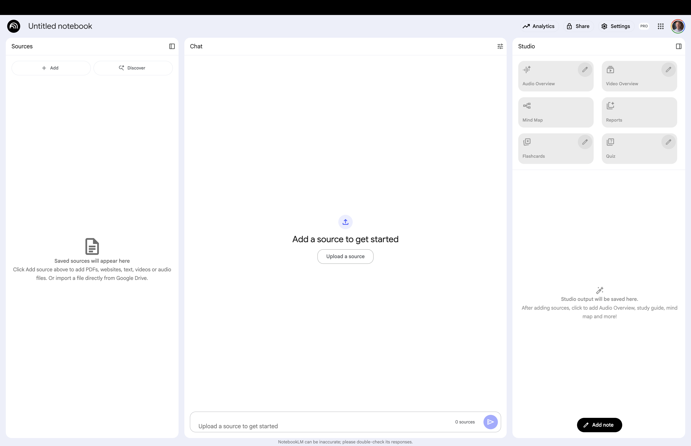{width="80%"}

:::

::: {.column width="20%" }

:::

::::

. . .

:::: {.columns}

::: {.column width="20%" .tiny-text }
**Sources area**: Upload and manage documents.   

:::

::: {.column width="30%" .tiny-text }
**Chat area**: Ask questions and get answers based on your own documents.  
:::


::: {.column width="30%" .tiny-text }
**Studio area**: Generate and save outputs like summaries, study guides, and notes.  
:::

::::


## Automatically Generated Summary 

:::: {.columns}

::: {.column width="60%" }

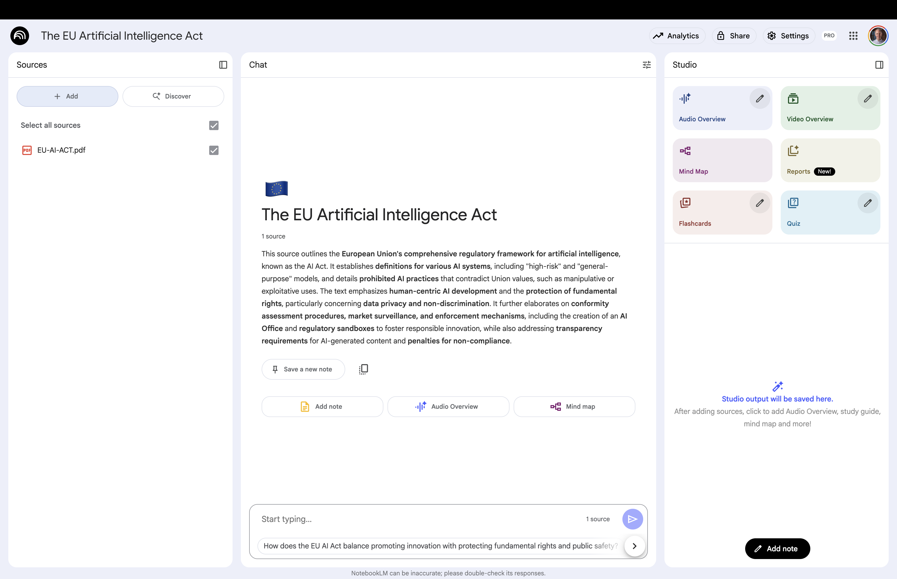

:::

::: {.column width="40%"}

<br>


:::

::::


:::: {.columns}

::: {.column width="56%" }

::: {.callout-note .fragment .fade-up}

The summary is automatically generated.

:::

:::

::::


## Save as Note 

:::: {.columns}

::: {.column width="60%"}
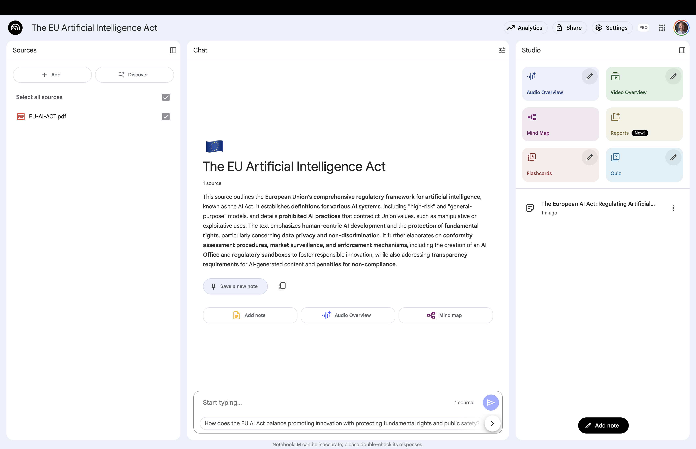
:::

::: {.column width="40%" .fragment .fade-left}

<br>

**1** In the **Chat area**: 

Select **Save to note**.

:::

::::


:::: {.columns}

::: {.column width="56%" }

::: {.callout-note .fragment .fade-up}

**2** The note appears in the "Notebook" within the **Studio area**.

:::

:::

::::


## Opening the Note 

:::: {.columns}

::: {.column width="60%"}
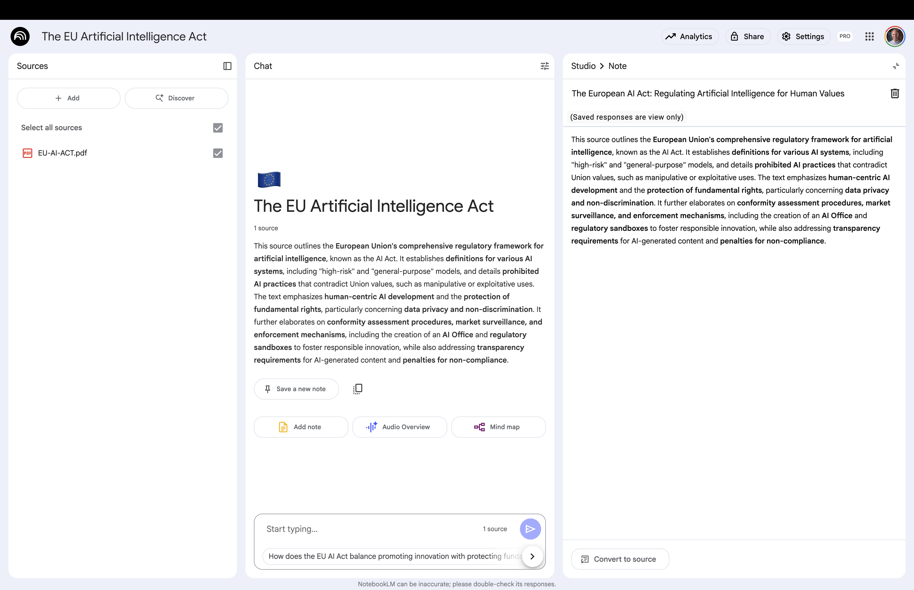
:::

::: {.column width="40%" .fragment .fade-left}
<br>

Click on the note in the **Studio area** to open it in a new window.

:::

::::


:::: {.columns}

::: {.column width="56%" }

::: {.callout-note .fragment .fade-up}

Saved response notes are not editable.

:::

:::

::::


# Chat {background-gradient="linear-gradient(to bottom, #FFDE00, #FFDE00)"}

Ask the model questions about source material   
or give instructions for actions.

## Selecting Sources 

:::: {.columns}

::: {.column width="60%"}
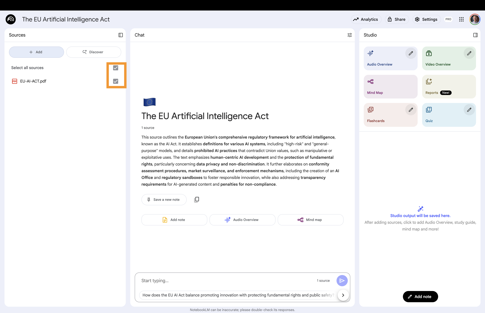
:::

::: {.column width="40%" .fragment .fade-left}
<br>

Use the checkbox for each source to include or exclude specific sources that the model should use to answer the question.

:::

::::


:::: {.columns}

::: {.column width="56%" }

::: {.callout-note .fragment .fade-up}

Sources can be added or removed by selecting **+ Add** or deselecting individual sources in the **Sources area**.

:::

:::

::::


## Asking the Model Questions

:::: {.columns}

::: {.column width="60%"}
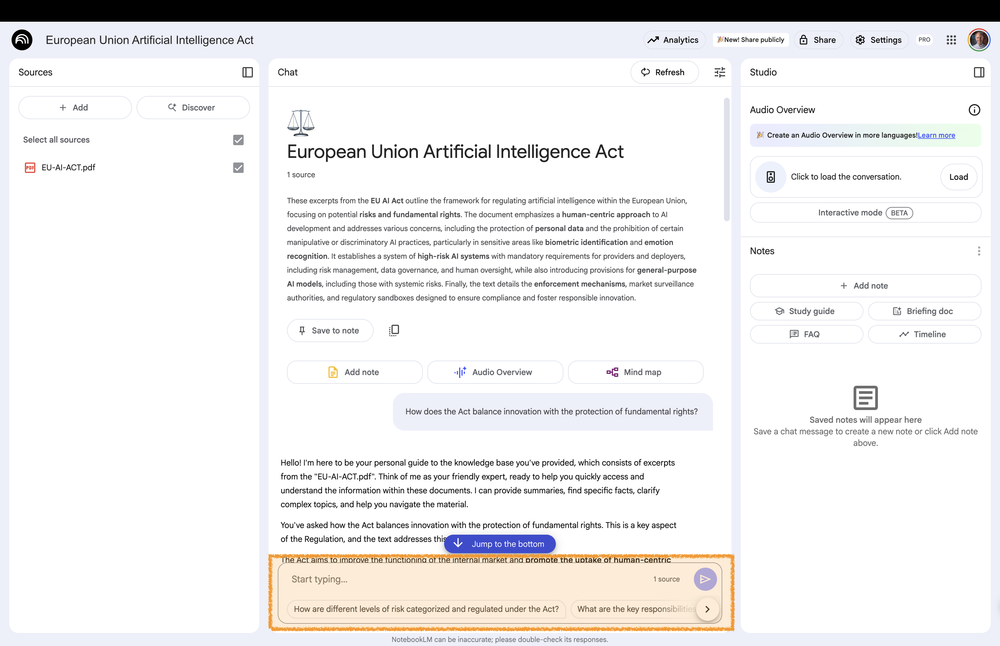
:::

::: {.column width="40%" .fragment .fade-left}

<br>

Enter a question in the chat window.


::: {.tiny-text .fragment .fade-up}

For example:

```md
What are the key insights  
from this document?
```

:::


:::

::::


## Citations 

:::: {.columns}

::: {.column width="60%"}
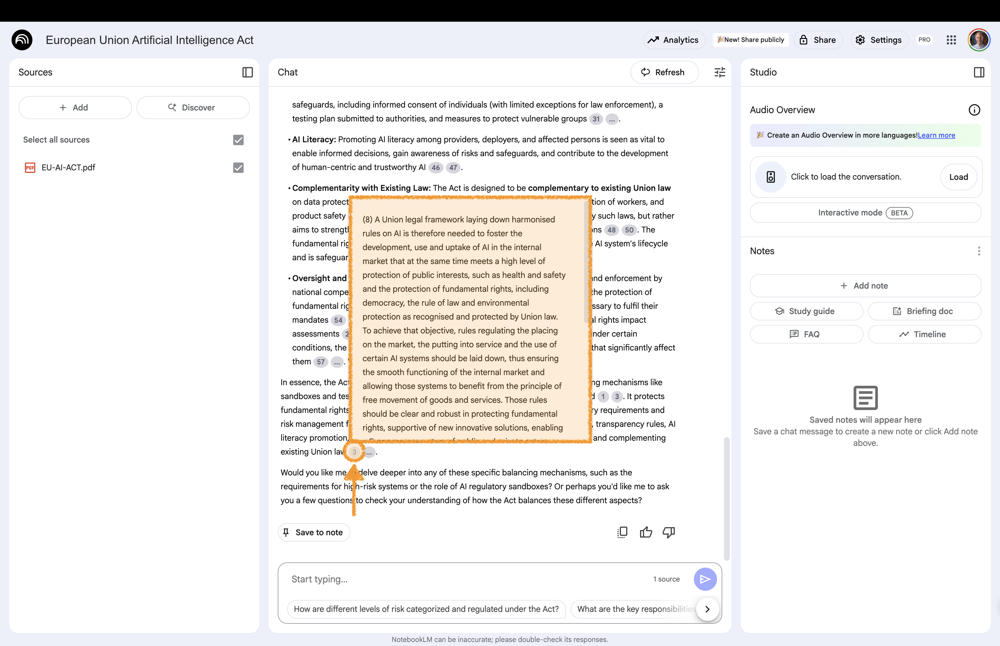
:::

::: {.column width="40%" .fragment .fade-left}
<br>

Selecting a citation leads to the corresponding location in the document.

:::

::::


:::: {.columns}

::: {.column width="56%" }

:::{.callout-note .fragment .fade-up}

Hovering over a citation displays the complete cited text.

:::
:::
::::


## Clear Chat 

:::: {.columns}

::: {.column width="60%"}
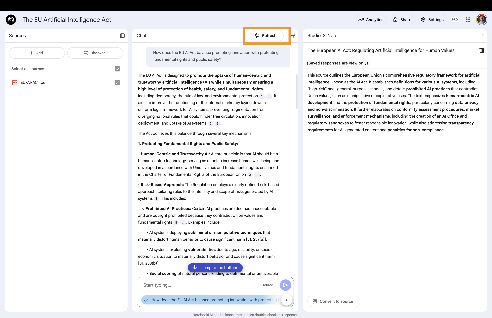
:::

::: {.column width="40%" .fragment .fade-left}
<br>

To delete the chat history, select **Refresh**.

:::

::::


## Customize Chat 


:::: {.columns}

::: {.column width="60%"}
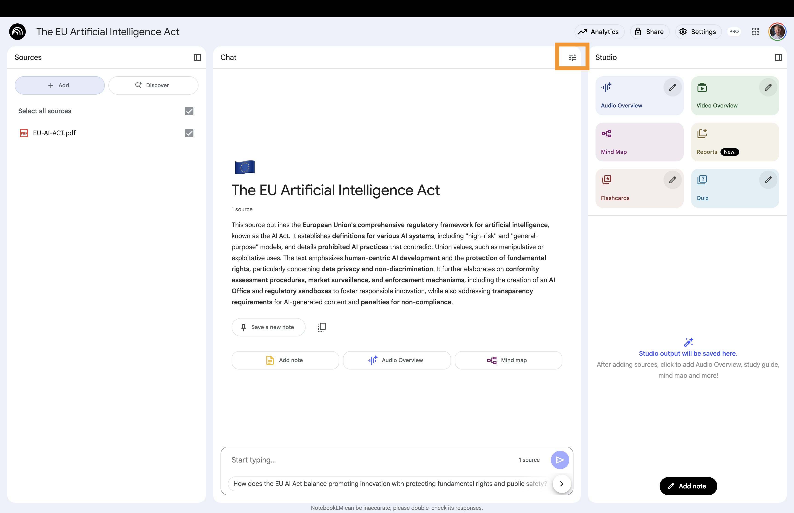
:::

::: {.column width="40%" .fragment .fade-left}
<br>

Navigate to **Configure notebook** in the chat area.

:::

::::


Conversation style and response length can be customized.


## Conversation Style: Default 


:::: {.columns}

::: {.column width="60%"}
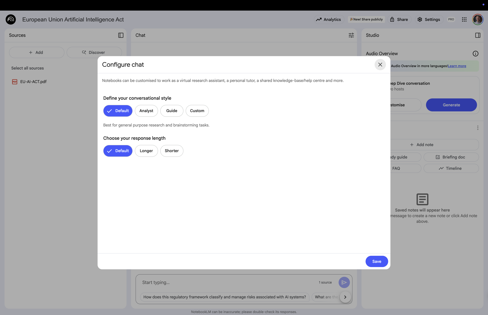
:::

::: {.column width="40%" .fragment .fade-left}
<br>

:::

::::

**Default**: Ideal for general research and brainstorming tasks.


## Conversation Style: Analyst 


:::: {.columns}

::: {.column width="60%"}
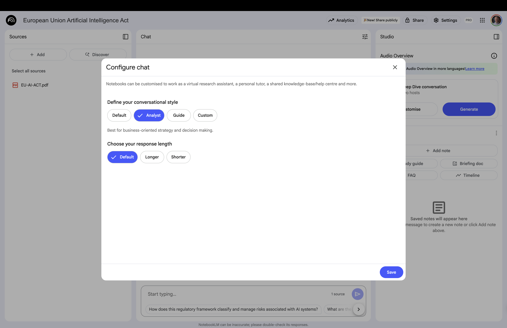
:::

::: {.column width="40%"}

:::

::::

**Analyst**: Ideal for business-oriented strategy and decision-making.


## Conversation Style: Guide 

:::: {.columns}

::: {.column width="60%"}
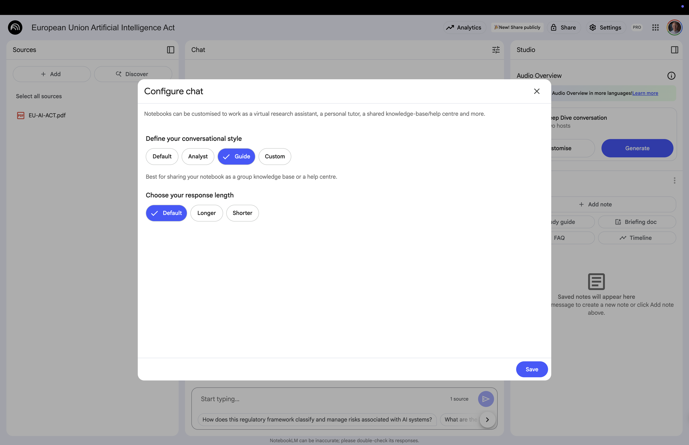
:::

::: {.column width="40%"}


:::

::::

**Guide**: Use the notebook as a knowledge base or help center.

## Conversation Style: Custom 


:::: {.columns}

::: {.column width="60%"}
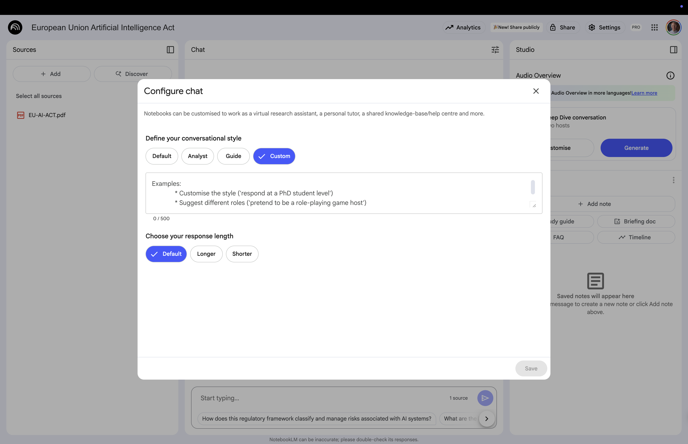
:::

::: {.column width="40%" .fragment .fade-left}


:::

::::


**Custom**: Optimal for defining a specific role.


**Response Length**: Response length is also selectable: *Default*, *Longer*, and *Shorter*.


# Mind Map {background-gradient="linear-gradient(to bottom, #FFDE00, #FFDE00)"}

Mind maps visually summarize uploaded sources   
and display main topics as well as related ideas as   
a branched diagram.

## Creating a Mind Map 


:::: {.columns}

::: {.column width="60%"}
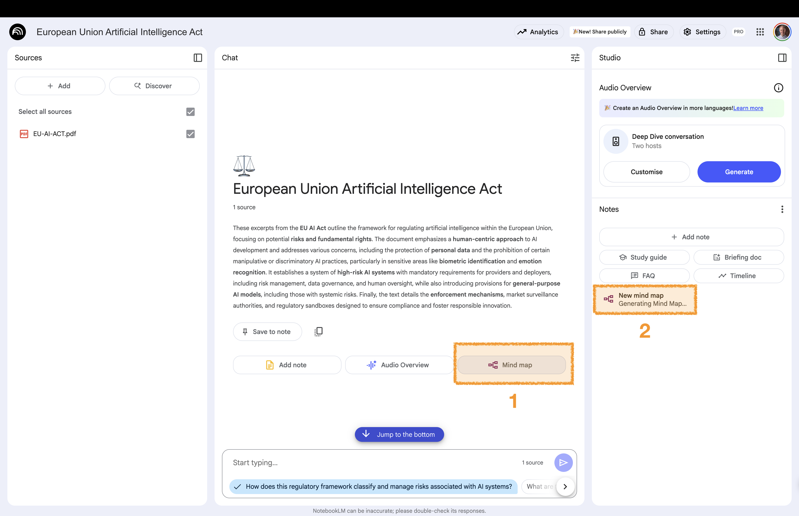
:::

::: {.column width="40%"}
<br>

**1** In the **Chat area**, select the mind map chip.

**2** The mind map appears in the **Studio area**.

:::

::::

## Interacting with a Mind Map 

:::: {.columns}

::: {.column width="60%"}
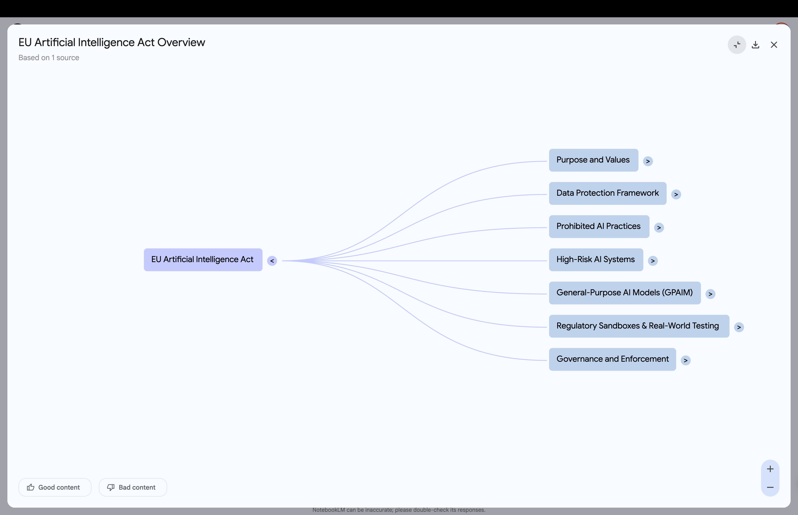
:::

::: {.column width="40%"}
<br>

Open the mind map in the **Studio area**.

Expand or collapse branches with **>**.

Change view, download, or close (top right corner).

:::

::::


## Select Nodes to Ask Questions

:::: {.columns}

::: {.column width="60%"}
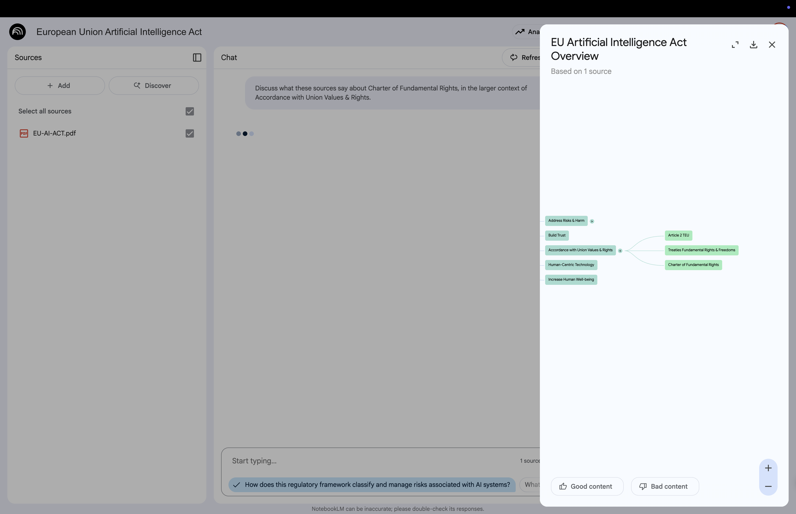
:::

::: {.column width="40%"}
<br>

Select a node to ask questions and chat about this specific topic.

:::

::::


# Audio Overview {background-gradient="linear-gradient(to bottom, #FFDE00, #FFDE00)"}

Audio overviews are audio discussions   
between AI moderators that provide summaries   
of topics in the uploaded sources.

## Choose Output Language 


:::: {.columns}

::: {.column width="60%"}
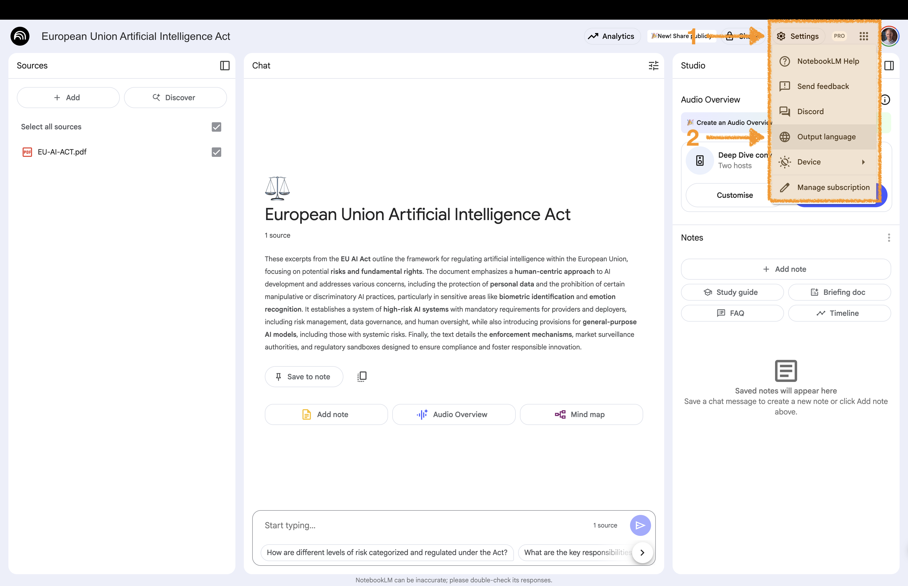
:::

::: {.column width="40%"}
<br>


**1** Navigate to **Settings**. 

**2** Select the **Output language**.

:::

::::

Audio overviews can be created in over 50 languages.


## Creating an Audio Overview 


:::: {.columns}

::: {.column width="60%"}
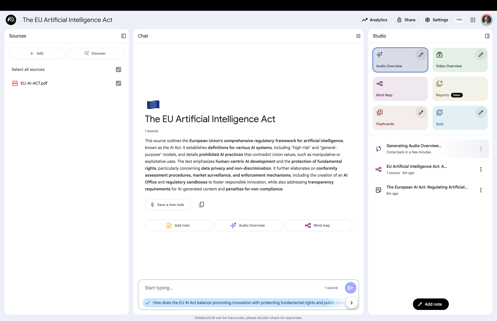
:::

::: {.column width="40%"}
<br>


**1** In the **Studio area**, navigate to the "Audio overview" section.

**2** Under "Deep dive conversation," select **Generate**.

:::

::::


## Interacting with an Audio Overview 


:::: {.columns}

::: {.column width="60%"}
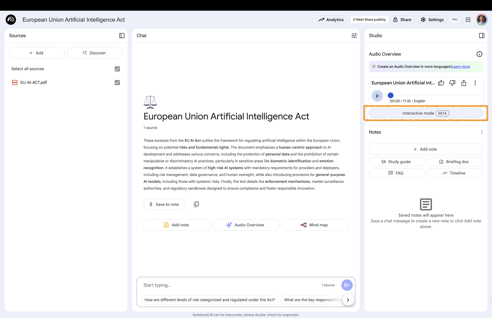
:::

::: {.column width="40%"}
<br>

Select **Interactive mode** (BETA).

Select **Play audio**.

While listening, select **Join** and ask a question.


:::

::::


## Managing the Audio Overview 


:::: {.columns}

::: {.column width="60%"}
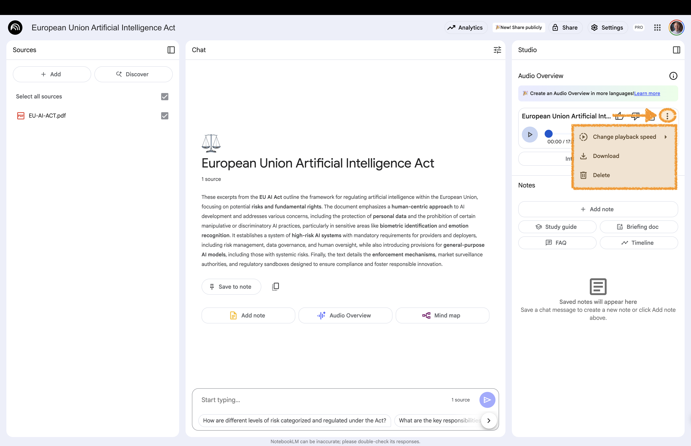
:::

::: {.column width="40%"}
<br>

Change speed, download audio, or delete.


Select "More" to:

:::{.small-text}

**1** Change the playback speed.

**2** Download the audio as mp3.

**3** Delete the audio overview.

:::

:::

::::

## Custom Audio Overviews 


:::: {.columns}

::: {.column width="60%"}
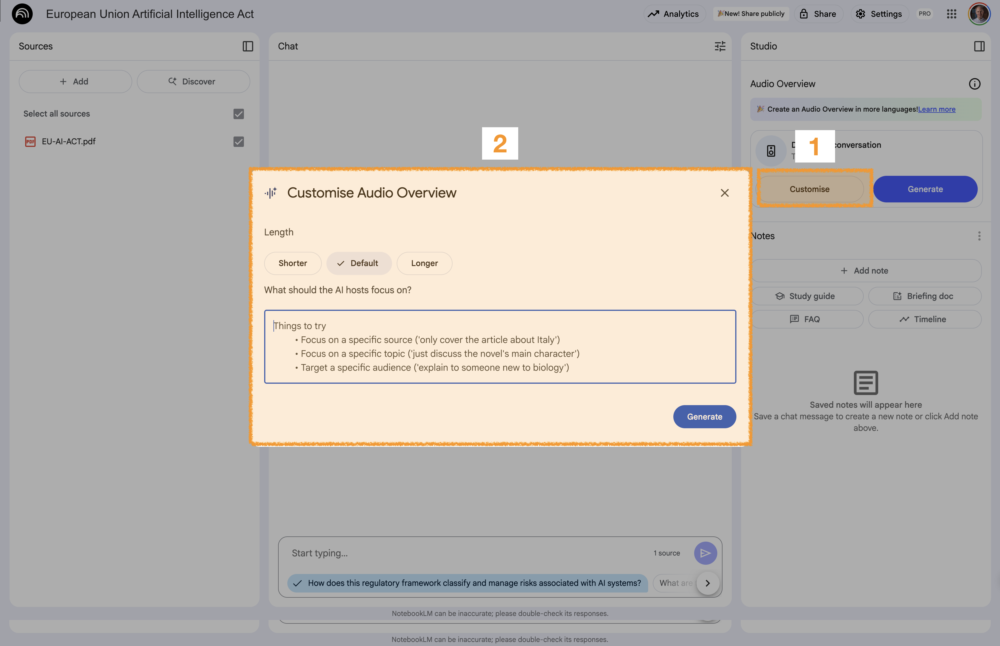
:::

::: {.column width="40%"}

*If an audio overview already exists, it must be deleted first.*

**1** In the **Studio area**, navigate to the "Audio overview" section.

**2** Under "Deep dive conversation," select **Customize**.


:::{.tiny-text}

Enter a custom prompt (max. 500 characters).

Example prompt (adjust placeholders):

```md
Create an audio overview for [TARGET_AUDIENCE] 
with a [TONE] tone. 
Focus on [FOCUS] and aim for [DURATION]. 
Cover key insights with concrete examples.

PLACEHOLDERS

[TARGET_AUDIENCE] = Kärcher management
[TONE] = professional
[FOCUS] = practical insights  
[DURATION] = 8-10 min.
```

:::

:::

::::


# Study Guide {background-gradient="linear-gradient(to bottom, #FFDE00, #FFDE00)"}

Automates the process of identifying key vocabulary   
and formulating relevant quiz questions.


## Quiz Questions and Glossary 


:::: {.columns}

::: {.column width="60%"}
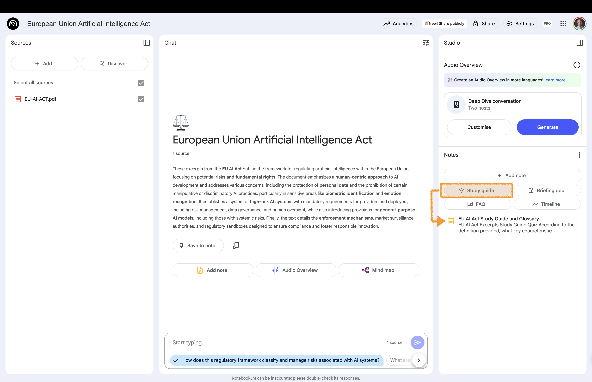
:::

::: {.column width="40%" .fragment .fade-left}
<br>


**Studio area**:  
Click on **Study Guide**.

:::

::::

Creates a quiz for self-assessment and a glossary with key terms.


## Opening the Study Guide Note 


:::: {.columns}

::: {.column width="60%"}
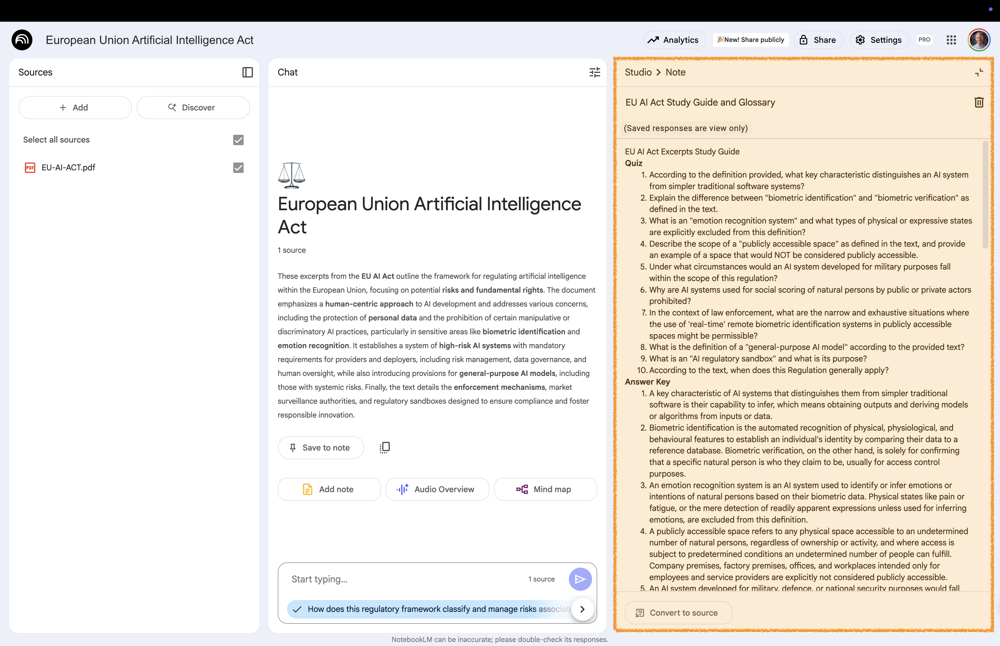
:::

::: {.column width="40%" .fragment .fade-left}
<br>

**Studio area**:  
Open the newly created note.

Take a look at the questions, answer key, and glossary.

:::

::::


# Briefing Document {background-gradient="linear-gradient(to bottom, #FFDE00, #FFDE00)"}

Summarizes key topics, definitions, and timelines  
from the provided sources. 

## Creating an Overview of Key Topics


:::: {.columns}

::: {.column width="60%"}
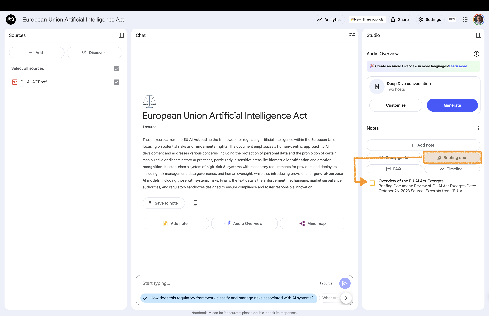
:::

::: {.column width="40%" .fragment .fade-up}
<br>

**Studio area**:  

Click on **Briefing doc**.

:::

::::


## Opening the Briefing Document

:::: {.columns}

::: {.column width="60%"}
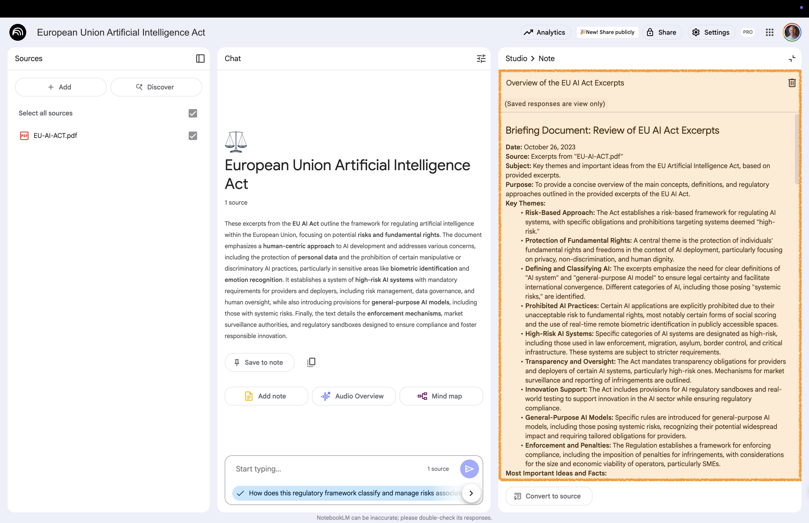
:::

::: {.column width="40%" .fragment .fade-up}
<br>

**Studio area**:  

Open the newly created note.

Take a look at the briefing document.

:::

::::


# FAQ {background-gradient="linear-gradient(to bottom, #FFDE00, #FFDE00)"}

Creates "question-answer" pairs to get a general,   
structured overview of the main topics in the documents.

## Creating FAQs 

:::: {.columns}

::: {.column width="60%"}
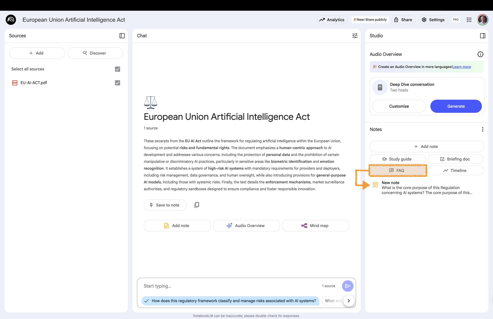
:::

::: {.column width="40%" .fragment .fade-up}
<br>

**Studio area**:  

Click on **FAQ**.

:::

::::

Creates a "question-answer" pair format.


## Opening FAQ 

:::: {.columns}

::: {.column width="60%"}
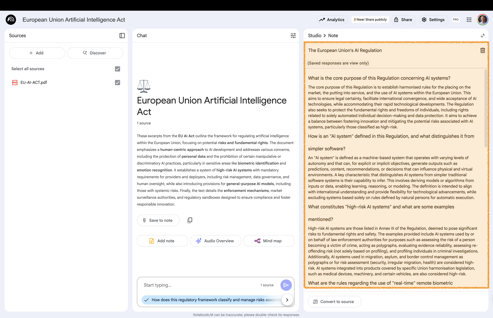
:::

::: {.column width="40%" .fragment .fade-up}
<br>

**Studio area**:  

Open the newly created note.

Take a look at the FAQ.

:::

::::


# Timeline {background-gradient="linear-gradient(to bottom, #FFDE00, #FFDE00)"}

Quickly understand the sequence of events in the documents. 

Perfect for creating historical overviews,   
tracking project progress, or  
outlining a biography.

## Creating a Timeline 

:::: {.columns}

::: {.column width="60%"}
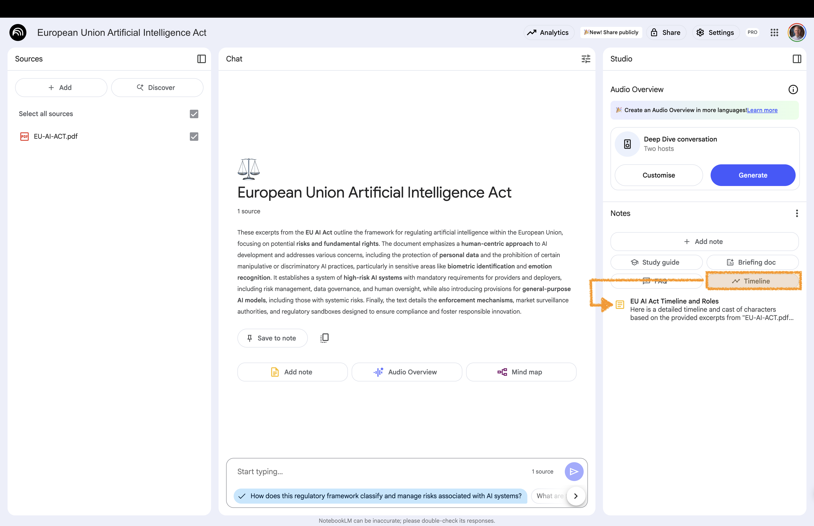
:::

::: {.column width="40%" .fragment .fade-left}
<br>

**Studio area**:  

Click on **Timeline**.

:::

::::

Timeline and person directory based on the provided sources.


## Opening the Timeline 

:::: {.columns}

::: {.column width="60%"}
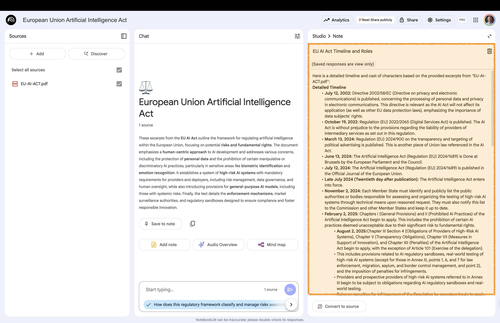
:::

::: {.column width="40%" .fragment .fade-left}
<br>

**Studio area**:  

Open the newly created note.

Take a look at the timeline.

:::

::::


# Discover Sources {background-gradient="linear-gradient(to bottom, #FFDE00, #FFDE00)"}

Enables discovering relevant sources from the web   
and importing them directly into the notebook.

## Discovering New Sources 

:::: {.columns}

::: {.column width="60%"}
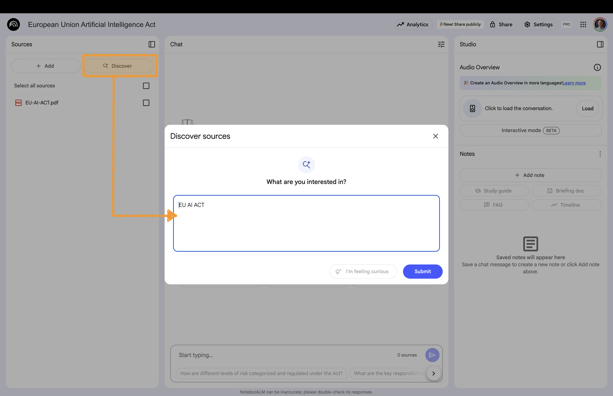
:::

::: {.column width="40%" .fragment .fade-left}
<br>

**Sources area**:  

Click on **Discover**.

Enter any topic of interest (EU AI Act was entered here).

:::

::::


## Selecting and Adding Discovered Sources 

:::: {.columns}

::: {.column width="60%"}
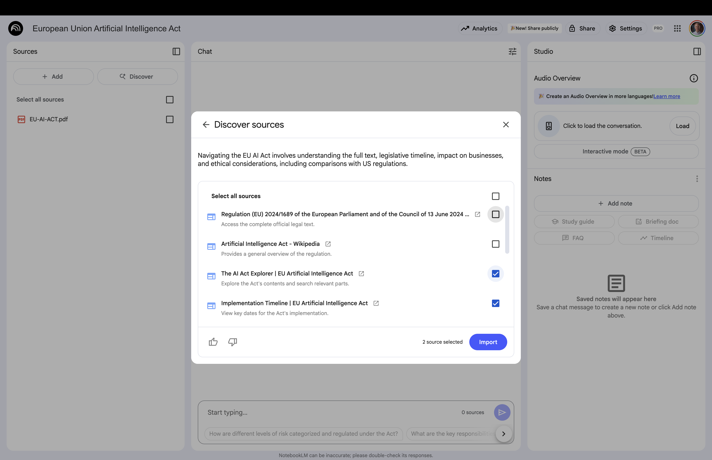
:::

::: {.column width="40%" .fragment .fade-left}
<br>

Select the discovered sources you want to keep.

:::

::::

## Using New Sources 

:::: {.columns}

::: {.column width="60%"}
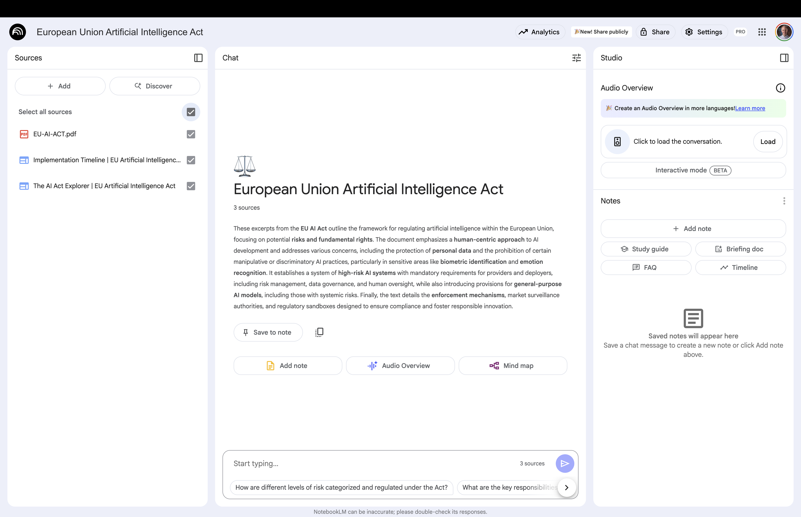
:::

::: {.column width="40%" .fragment .fade-left}
<br>

Select the sources to work with and create new content (like mind maps, etc.).

:::

::::


# Notes {background-gradient="linear-gradient(to bottom, #FFDE00, #FFDE00)"}

Organize information and add your own thoughts.

## Creating & Adding Notes 


:::: {.columns}

::: {.column width="60%"}
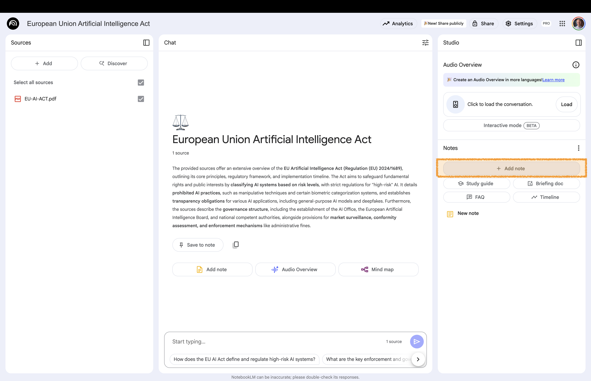
:::

::: {.column width="40%" .fragment .fade-up}
<br>

**Studio area**:  

In the **Notes** section select **Add note**.

Text can be written or pasted into this note.

:::

::::

Up to 1,000 notes can be created per notebook.

## Converting Notes to Sources


:::: {.columns}

::: {.column width="60%"}
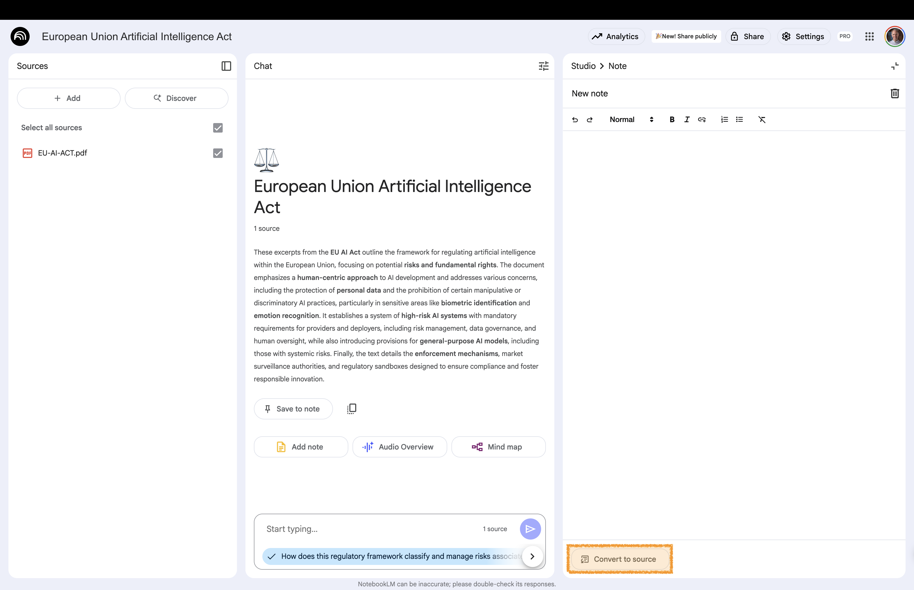
:::

::: {.column width="40%" .fragment .fade-up}
<br>

**Studio area**:  

Open the note.

Select **Convert to source**.

:::{.small-text .fragment .fade-up}


*To convert all notes to sources:* Click **More** in the **Notes** section in the **Studio area**. 

Select **Convert all notes to sources**.

:::

:::

::::


. . .

Your own notes can be added to the sources.


# 2. Exercises - Quick Wins {background-gradient="linear-gradient(to bottom, #FFDE00, #FFDE00)"}

**Goal:** Become familiar with NotebookLM.

## Meeting Preparation 

:::: {.columns}

::: {.column width="60%" .fragment .fade-up}

:::

::: {.column width="40%" .fragment .fade-left }

<br>

1. Open [NotebookLM](https://notebooklm.google.com)
2. Select **Create new**
3. Upload a presentation (optional: add related documents)
4. Ask the following question in chat:

:::{.tiny-text .fragment .fade-up}

```markdown
Create a summary of the key insights I need to know.
Make it conversational, as if a colleague were briefing me over coffee.
```

:::

5. Save result as note 
6. Create an audio summary and check the result
7. Create a mind map and check the result


:::

::::

. . .

:::: {.columns}

::: {.column width="56%" }

:::{.callout-note .fragment .fade-up appearance="simple"}

**Having difficulties?** Simply raise your hand or ask in chat. Problems will be solved together!

:::

:::

::::


## Meeting Preparation 2

:::: {.columns}

::: {.column width="60%" .fragment .fade-up}

:::

::: {.column width="40%" .fragment .fade-left }

<br>

1. Use the same notebook
2. Click **Refresh** in the **Chat area**
3. Ask the following question in chat (replace the placeholder "Finance" with your own area):

:::{.tiny-text .fragment .fade-up}

```markdown
Extract the 5 most important decisions 
or recommendations from this document. 
Explain for each the rationale 
and potential impacts on [AREA].

[AREA] = "Finance"
```

:::

4. Save the result as **Note** 
5. Review the result


:::

::::


## Invitation to Share Experiences

:::: {.columns}

::: {.column width="60%" .fragment .fade-up}
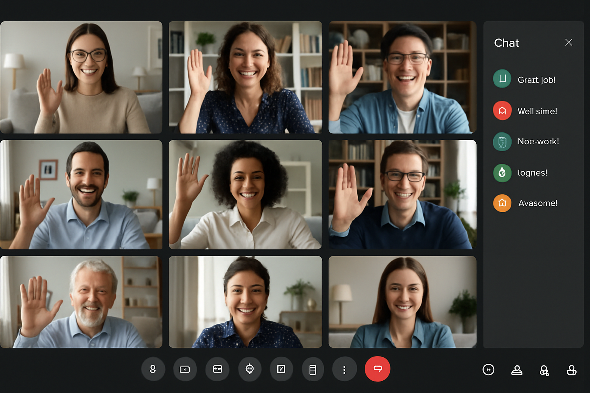
:::

::: {.column width="40%" .fragment .fade-left }

<br>

**A discussion in chat about:**

- The most important insights or "aha moments".


:::

::::


## Email Action Items

:::: {.columns}

::: {.column width="60%" .fragment .fade-up}

:::

::: {.column width="40%" .fragment .fade-left }

1. Open [NotebookLM](https://notebooklm.google.com)
2. Select **Create new**
3. Copy your email thread (print as PDF) and add to sources
4. Use the following prompt in chat:

::: {.fragment .tiny-text .fade-up}

```md
Summarize this email thread as  
1. Decisions made
2. Action items (who/what/when)
3. Open questions
4. Next required steps
```

:::

5. Save the response as **Note** for future reference
6. Review the results: Is the summary helpful?


:::

::::


## Customized Audio Summary

:::: {.columns}

::: {.column width="60%" .fragment .fade-up}

:::

::: {.column width="40%" .fragment .fade-left }

1. Open [NotebookLM](https://notebooklm.google.com)
2. Select **Create new**
3. Upload a (complex) document of your choice
4. Navigate to the "Audio overview" section in the Studio area
5. Under "Deep dive conversation" select **Customize**
6. Enter this customized prompt (max. 500 characters): 

::: {.fragment .tiny-text .fade-up}

```md
Create an audio overview that covers    
- Key insights to be drawn from this document  
- Important decisions or required actions  
- Critical information for the next meeting  
- Main points that can be shared with colleagues  
Make it conversational, as if a colleague were briefing over coffee. 
Focus on what's actionable and immediately useful.
```

:::

7. Select **Length** (use *Default*), create the audio overview and listen to the first two minutes.

:::

::::

## Extracting Insights from Videos


:::: {.columns}

::: {.column width="60%" .fragment .fade-up}

:::

::: {.column width="40%" .fragment .fade-left }

1. Start a new notebook (click the black icon in the top left)

2. Click **+ Create new** to start a new notebook.

3. To add the video, click **YouTube** and enter a link. For example: 

:::{.tiny-text .fragment .fade-up}

```txt
https://www.youtube.com/watch?v=3gWb3LNfX28
```

:::


3. Use the **Mind map** function to get an overview of the video's structure and main messages.

4. Use prompts to extract useful information, e.g.:

::: {.fragment .tiny-text .fade-up}

```md
Provide step-by-step instructions for using the Kärcher window vacuum for streak-free window cleaning, from assembly to maintenance.
```

:::

:::

::::


# 3. Use Cases {background-color="#FFED00"}

**Goal:** Master use cases that are actually applied.

## Select Use Case

::: { .fragment }

- A. **Presentation Preparation**: *Convert reports into presentation outlines*

- B. **Competitive Analysis**: *Analyze multiple competitor documents simultaneously*

- C. **Training Accelerator**: *Transform manuals into engaging content*

- D. **Communication Clarity**: *Precise communication*

- E. **Domain-Specific Use Case**: *Use a domain-specific use case*

:::


## A: Presentation Preparation

**Challenge:** Board presentation due Friday


:::: {.columns}

::: {.column width="60%" .fragment .fade-up}

:::

::: {.column width="40%" .fragment .fade-left }

1. Open [NotebookLM](https://notebooklm.google.com)
2. Select **Create new**
3. Upload the report or data documents
4. Use the following prompt in chat (adjust target audience and length):

::: {.tiny-text .fragment .fade-up}

Example prompt (adjust target audience and length):

```markdown
Create a presentation outline with  
- 5 compelling talking points
- Supporting data for each point  
- 3 key insights for executives
- 10 potential Q&A scenarios

Target audience: "Board of Directors"
Presentation length: "30 minutes"
```


:::

5. Save the result as **Note**
6. Create an **Audio summary** to practice the presentation
7. Create a **Mind map** for a visual overview

:::

::::

## B: Competitive Analysis

**Challenge:** Understanding the competitive landscape


:::: {.columns}

::: {.column width="60%" .fragment .fade-up}

:::

::: {.column width="40%" .fragment .fade-left }

1. Open [NotebookLM](https://notebooklm.google.com)
2. Select **Create new**
3. Upload multiple competitor materials
4. Use the following prompt in chat:

:::{.tiny-text .fragment .fade-up}

Example prompt:

```markdown
Compare these competitor documents and 
identify:
- Their main advantages
- Gaps in their offerings  
- Opportunities for Kärcher
- Price/positioning differences
Create a strategic summary.
```
:::

5. Save the result as **Note**
6. Ask follow-up questions about specific competitors
7. Create a **Mind map** to visualize the competitive landscape

:::

::::

## C: Training Accelerator

**Challenge:** Making technical content engaging

:::: {.columns}

::: {.column width="60%" .fragment .fade-up}

:::

::: {.column width="40%" .fragment .fade-left }

1. Open [NotebookLM](https://notebooklm.google.com)
2. Select **Create new**
3. Upload the technical training materials
4. Use the following prompt in chat (adjust placeholders):

:::{.tiny-text .fragment .fade-up}

Example prompt (adjust placeholders):

```markdown
Transform this technical manual into  
- 10 practical use cases/examples
- Interactive Q&A for self-assessment
- Checklist with key points
- Common mistakes to avoid
Make it engaging for [TARGET_AUDIENCE].

[TARGET_AUDIENCE] = "Kärcher Project Managers"
```
:::


5. Save the result as **Note**
6. Create an **Audio summary** for auditory learners


:::

::::

## D: Communication Clarity

**Challenge:** Precise communication

:::: {.columns}

::: {.column width="60%" .fragment .fade-up}

:::

::: {.column width="40%" .fragment .fade-left }
1. Open [NotebookLM](https://notebooklm.google.com)
2. Select **Create new**
3. Upload relevant documents for context
4. Use the following prompt in chat (adjust placeholders):

::: {.tiny-text .fragment .fade-up}
Example prompt:
```markdown
Based on these documents, write a 
[TEXT] that:
- Clearly presents the situation
- Provides necessary context
- Recommends specific actions
- Includes next steps and timeline
The tone should be [TONE]  
PLACEHOLDERS:
[TEXT] = "email"
[TONE] = "friendly"
```
Placeholder examples:

[TEXT] = "email" or "update" or "proposal", ...   
[TONE] = "professional" or "casual" or "urgent", ...
:::

5. Save the result as **Note**

:::

::::


## E: Department-Specific 

- Overview of [department-specific use cases](/use-cases-domains.qmd) (e.g., Marketing, Sales, Operations & Manufacturing, Quality Assurance, HR, Finance, Technical Documentation)


## Sharing Tips

:::: {.columns}

::: {.column width="60%" .fragment .fade-up}

:::

::: {.column width="40%" .fragment .fade-left }

<br>

**Invitation to share:**

Insights?  
Recommended prompt?

:::

::::


# Conclusion {background-color="#FFED00"}


# The Implementation Plan {background-gradient="linear-gradient(to bottom, #FFDE00, #FFDE00)"}


- [Plan in Google Docs](https://docs.google.com/document/d/1YqZlxx7XClfPxRytOi3qVODlh49KGmt11Z952422F3Q/edit?usp=sharing)


:::: {.columns}

::: {.column width="56%" }

::: {.callout-note .fragment .fade-up}

**Follow-up survey in 2 weeks:** Time to share success stories!

:::

:::
::::


## Review

:::: {.columns}

::: {.column width="60%" .fragment .fade-up}

:::

::: {.column width="40%" .fragment .fade-left }

<br>

✅ Learned NotebookLM features

✅ Worked on some use cases 

✅ Ready for continued use!   


:::

::::


# Questions? {background-color="#FFED00"}


Note: Seminar "Prompt like a Pro: Gemini Deep Dive".

# Thank You! {background-color="#FFED00"}

Jan Kirenz   
[kirenz@hdm-stuttgart.de](mailto:kirenz@hdm-stuttgart.de)
