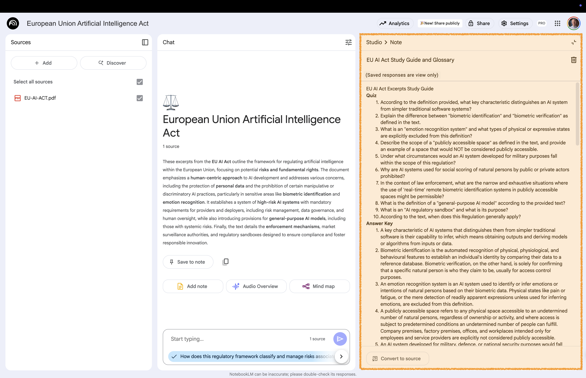

# Study-Guide {background-gradient="linear-gradient(to bottom, #FFDE00, #FFDE00)"}

Automates the process of identifying key vocabulary   
and formulating relevant quiz questions

## Quiz Questions and Glossary 

:::: {.columns}

::: {.column width="60%"}

:::

::: {.column width="40%" .fragment .fade-left}
 

**Studio area**:  
Click on **Study Guide**

:::

::::

Creates a self-review quiz and glossary with key terms

## Open the Study Guide Note 

:::: {.columns}

::: {.column width="60%"}

:::

::: {.column width="40%" .fragment .fade-left}
 

**Studio area**:  
Open the newly created note

Take a look at the questions, answer key, and glossary

:::

::::

# Back to Website {background-gradient="linear-gradient(to bottom, #FFDE00, #FFDE00)"}

[Workshop Website](https://kirenz.github.io/notebooklm/)