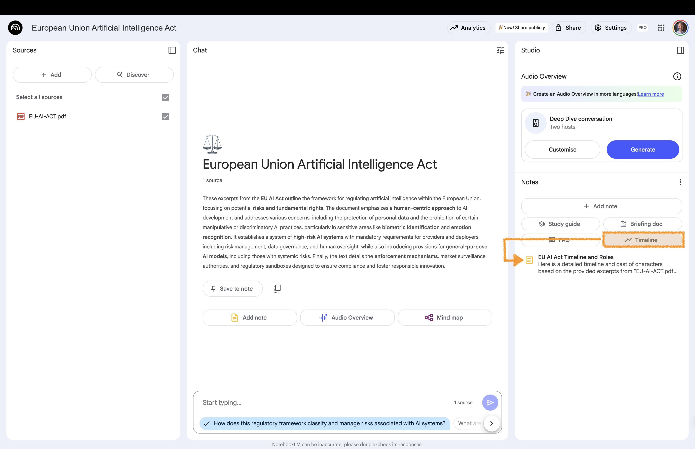
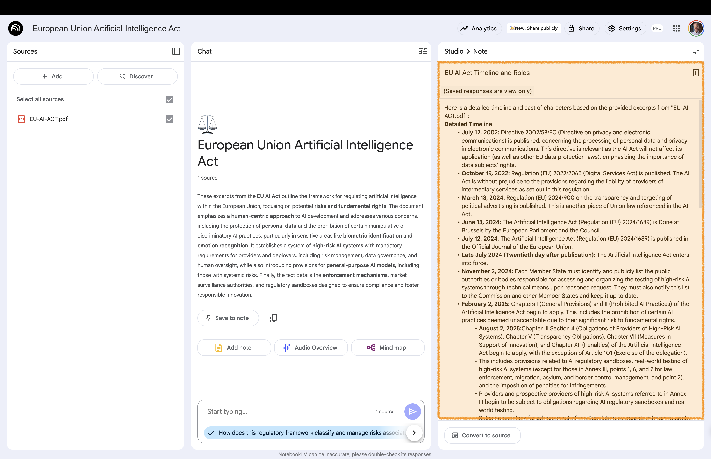

# Timeline {background-gradient="linear-gradient(to bottom, #FFDE00, #FFDE00)"}

Quickly understand the sequence of events   
in your documents. 

Perfect for creating historical overviews,   
tracking project progress, or outlining a  
 biography

## Create Timeline 

:::: {.columns}

::: {.column width="60%"}

:::

::: {.column width="40%" .fragment .fade-left}
 

**Studio area**:  
Click on **Timeline**

:::

::::

Timeline and character directory based on the provided sources.

## Open Timeline 

:::: {.columns}

::: {.column width="60%"}

:::

::: {.column width="40%" .fragment .fade-left}
 

**Studio area**:  
Open the newly created note

Take a look at the timeline

:::

::::

# Back to Website {background-gradient="linear-gradient(to bottom, #FFDE00, #FFDE00)"}

[Workshop Website](https://kirenz.github.io/notebooklm-de/)