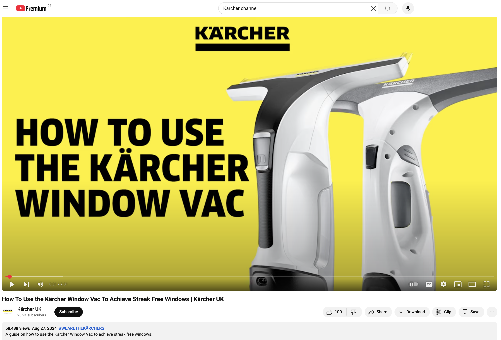
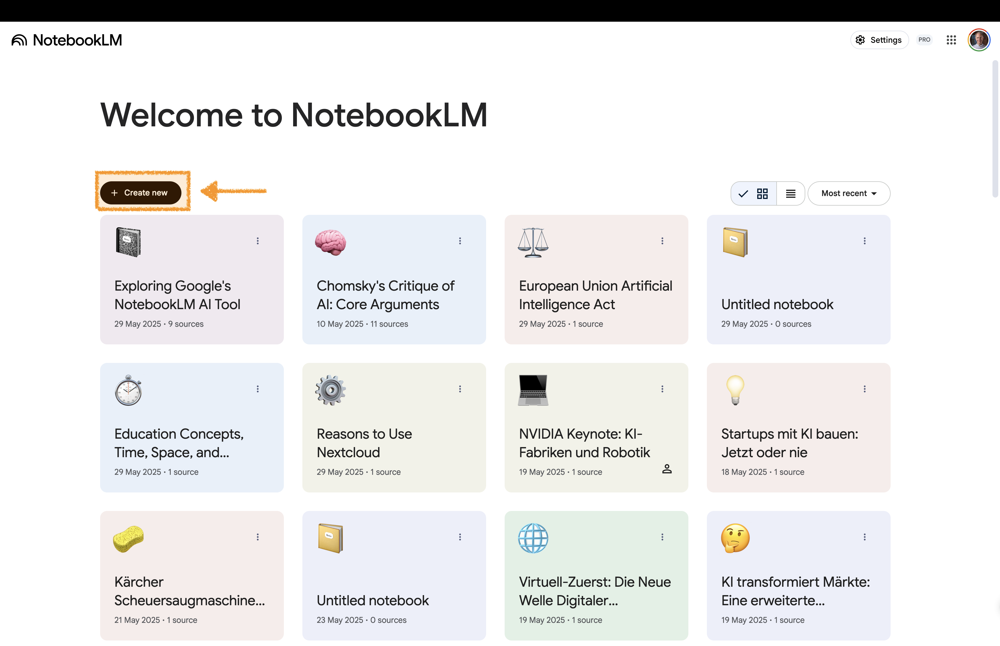
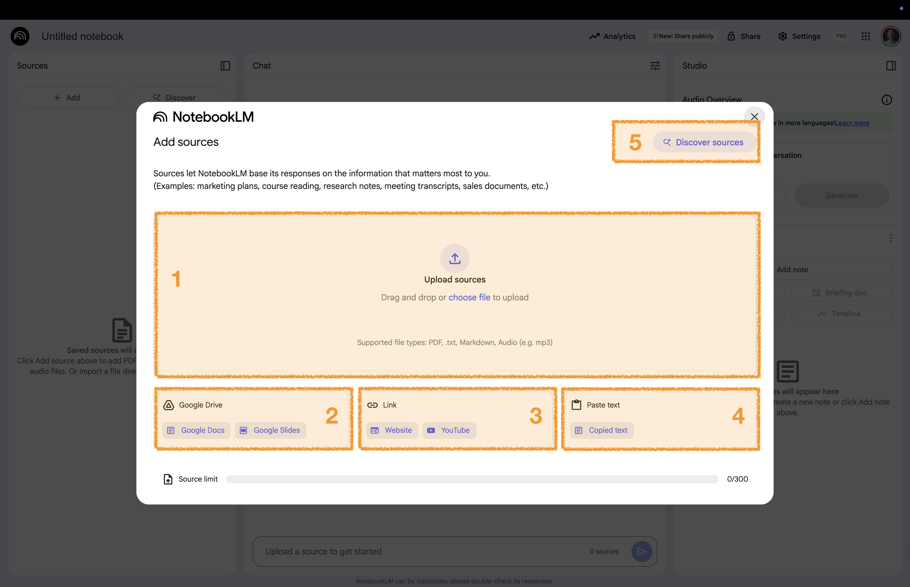

# Video Extraction {background-gradient="linear-gradient(to bottom, #FFDE00, #FFDE00)"}

You can also use a video as a source. 
Gemini Notebook imports the transcript.


## Youtube Video: Window Cleaner




<div style="position: absolute; bottom: 10px; left: 0px; font-size: 0.4em; color: #666;">
Source: [YouTube](https://www.youtube.com/watch?v=3gWb3LNfX28)
</div>


## Create a New Notebook 

:::: {.columns}

::: {.column width="60%"}

:::

::: {.column width="40%" .fragment .fade-left}
<br>

[🔗 Open Gemini Notebook](https://notebooklm.google/)

To create a new notebook, select: 

**+ Create new**
:::

::::

## Add Your YouTube Video  

:::: {.columns}

::: {.column width="60%"}

:::

::: {.column width="40%"  .fragment .fade-left .custom-small}

<br>

To add a video: 

**3** Click on **YouTube**

Enter a link to a video. 

:::{.tiny-text}

Example Kärcher video:

```txt
[https://www.youtube.com/watch?v=3gWb3LNfX28]
```
:::

:::

::::


# Explore More Resources{background-gradient="linear-gradient(to bottom, #FFDE00, #FFDE00)"}


[Continue on the Workshop Website](https://kirenz.github.io/notebooklm/)